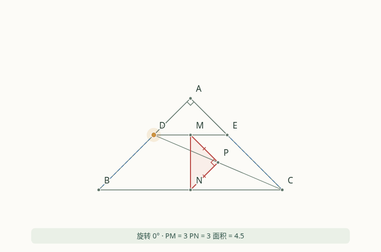

# 四题交互动态图

配合[进阶摸底卷与逐步图解](../grade8_selected/README.md)，制作可直接拖动、调滑块和自动播放的课堂演示。默认打开第4题。

- [交互演示HTML](index.html)：电脑端可点击GitHub页面的 **Download raw file／下载原始文件**，保存为 `index.html` 后用浏览器打开。整个演示包含在一个文件内，运行时不需要联网。iPhone/iPad请看下面的打开方法。
- [下载演示包](geometry_motion.zip)：包内仅放可直接使用的文件，解压后打开 `index.html`；不再混入容易误开的开发模板。
- [第4题GIF动画预览](question4_rotation.gif)：可直接在GitHub里观看；GIF本身不能拖动，可调节版请打开HTML。

## iPhone与iPad怎么打开

iOS“文件”App直接打开HTML时，常使用Quick Look快速预览，可能不执行JavaScript。该演示的动点和图形由JavaScript计算，因此会出现页面文字能看到、图形或控制不能使用的情况。它与在Safari里访问正常网页不是同一种运行方式；从“文件”分享或预览也不能保证切换到可执行脚本的页面。

2026-10-16兼容更新：不运行脚本时，页面仍会显示嵌入文件内的静态图，以及明确的打开方法提示；互动按钮会保持禁用。成功运行脚本后，才切换到动态图并启用控件。这样不会把静态预览误当成已经可操作的演示。

要在iPhone/iPad上拖动，推荐启用本仓库的GitHub Pages，然后**在Safari打开在线地址**。发布入口和静态站点文件已准备好，仓库管理员只需设置一次：

1. 打开[仓库的Pages设置](https://github.com/qq459669253/jiajiao/settings/pages)。
2. 在“Build and deployment”中，Source选“Deploy from a branch”，Branch选`main`，目录选`/(root)`，点击Save。
3. 等设置页显示发布成功后，在Safari打开 `https://qq459669253.github.io/jiajiao/`，它会进入动态图。

上面是启用后的预期网址，是否已发布以GitHub Pages设置页为准；当前执行环境无法访问Pages配置接口或验证该网站的发布状态。本说明不把“已上传文件”当作“网站已上线”。

如果暂时只需要观看运动过程，可直接打开[GIF预览](question4_rotation.gif)；需要逐步证明可看[图解教师答案](../grade8_selected/selected_teacher.pdf)。

## 可以怎样操作

| 题目 | 拖动哪个点 | 图形怎样联动 |
|---|---|---|
| 第1题 | M，限制在BD上 | N同步旋转，AM、BM、CM和折线ENMC同步变化，可一键跳到最短路径的位置 |
| 第2题 | P，限制在CD上 | 两个等边三角形及其中点M同步变化；显示固定点Q和M的直线轨迹KL |
| 第3题 | E，沿BC或其延长线移动 | F按半角条件确定，G按BG=DF确定；可切换正方形、一般四边形和延长线位置 |
| 第4题 | D，绕A旋转 | E同步保持AD=AE、∠DAE=90°；M、P、N始终是相应边的中点，实时显示长度、直角和面积 |

每题都可使用滑块、自动播放／暂停、显示辅助线、显示轨迹、隐藏数值。下面的步骤按钮只切换本步重点，动点仍可继续调节。第4题点击“到最大面积的位置”，可看到D、A、B依次共线，PM=PN=7，面积49/2。

第3题的三种位置分开演示，保持原题要求。延长线模式选取E与F都位于相应延长线上的合法区间；它不把跨越未满足条件的位置当作原题情形。

“保存当前图”可以导出SVG，方便配合口头证明或补进讲义。可拖动的点显示为金色。

## 第4题动画预览



课堂建议先隐藏数值，让学生预测哪些关系不变，再开启数值并切换到相应的证明步骤。动态观察用于理解结构，不能代替全等、平行和最值取等的证明。

## 来源与重建

题目沿用现有选编，出处见[原资料说明](../grade8_selected/README.md)。本目录交互程序和教学示意图为2026-10-16独立制作，以GPL-3.0-or-later提供，许可全文见LICENSE。

`index.html`是可以单独使用的完整成品；`geometry.js`保存几何约束，`app.js`处理交互，`template.html`保存版式。仅重建HTML和下载包需要Python标准库：

```bash
python build_motion.py
```

演示不使用CDN、外部字体或联网服务。浏览器内的实测值采用小数近似显示，底层图形始终按题目约束重新计算。

`static_preview.png`是随源代码保存的默认静态图，构建时以data URI嵌入HTML，供不运行脚本的预览器显示。开发源文件保留在仓库中；下载包只包含成品HTML、说明、GIF和许可文件。

开发核对可运行 `python verify_motion.py`（需要Playwright及Chromium），检查1206组几何位置、四题鼠标拖动、播放暂停、步骤切换、离线执行、手机触控与SVG导出。动画预览由实际交互页面渲染：`python render_preview.py`（另需Pillow）；之后重新运行 `python build_motion.py` 将GIF加入下载包。
