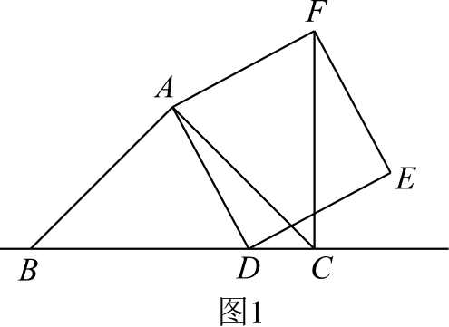
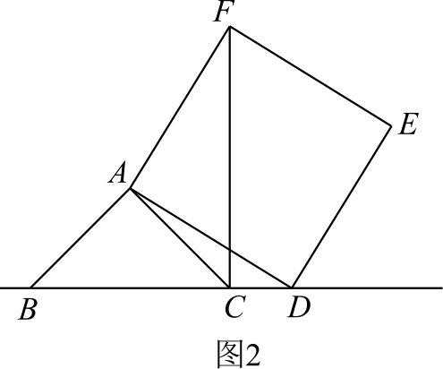

# 两道补充题（学生题面）

## 题1：中等

已知，在△ABC中，∠BAC=90°，∠ABC=45°，D为直线BC上的动点（不与B、C重合），以AD为边作正方形ADEF，连接CF。
（1）如图1，当D在线段BC上时，求证：BC=CF+CD。
（2）如图2，当D在线段BC的延长线上时，其他条件不变，请直接写出BC、CD、CF三条线段之间的数量关系。

 

## 题2：综合压轴

（1）如图a，在四边形ABCD中，AB=CD，E、F分别是BC、AD的中点。直线EF与BA、CD的延长线分别交于M、N。求证：∠BME=∠CNE。
（2）如图b，在四边形ADBC中，AB=CD，E、F分别是BC、AD的中点。AB与CD交于O，直线EF与DC、AB分别交于M、N，M、N、O互不重合。判断△OMN的形状，并证明。
（3）如图c，在△ABC中，AC>AB，D在AC上，且AB=CD。E、F分别为BC、AD的中点，直线EF与BA的延长线交于G。若∠EFC=60°，连接GD，判断△AGD的形状，并证明。

