# 两道补充题：逐步配图教师答案

题目来源与编排说明见[README](README.md)。

## 为什么这两题分档

题1只需一次SAS识别BD=CF，再按D的位置作加减，作为中等题。题2前两问需要主动倍长BF，把AD的中点转换为BH的中点，再用中点连线和平行线找到等腰结构；第三问要放弃机械沿用H，另构造T，并连续识别两个等边三角形和一个等腰三角形。按辅助线层数和末问迁移要求，题2与原卷24题的中点构造、25题的特殊三角形综合要求相近。

## 知识范围

全等SAS、等腰与等边三角形、平行线角关系、中点性质。两题均不需要勾股定理、根式运算、相似、圆或函数。中点连线的平行性质若尚未学，可先给出，并用附录的两次SAS补证；不要将未学过性质直接判为能力不足。

## 两小时的一种安排

独立完成两题40—45分钟；批改与追问10分钟；重点讲解40—45分钟；遮住原解重建关键辅助线15分钟；最后5分钟复述。若与前四题混用，应替换其中一部分，不能把六道综合题都按原50分钟塞进去。

## 本次答案与评分

题1：（1）BC=CF+CD；（2）BC=CF-CD。各6分：全等条件3分、CF=BD及结论3分。
题2：（1）∠BME=∠CNE；（2）OM=ON，△OMN为等腰三角形；（3）∠AGD=90°，∠ADG=30°。第（1）（2）问各6分；末问12分，建议构造T并得到F为TC中点4分、证明△TAB等边2分、证明△AGF等边2分、等腰△GFD角度与直角结论4分。

## 出处说明

题1取公开题库T22-A01-08的前两问，题2取公开讲义习题6.25.11完整三问。原图、原文摘录、固定版本链接与许可随包保存；图b中O已在原图标出，本次按原图补写交点定义，并明确M、N、O互异，保持原图所示的非退化三角形情形。下面各步骤图是独立重绘的教学图。

## 题1：中等题｜（1）旋转全等，再把BD拆成两段

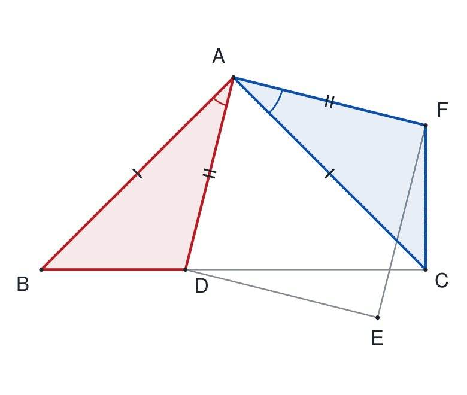

**作图：** 连接CF，比较△BAD与△CAF。

由∠BAC=90°、∠ABC=45°，得AB=AC。

正方形给AD=AF、∠DAF=90°。

∠BAD=90°-∠DAC=∠CAF。

所以△BAD≌△CAF（SAS），BD=CF。

D在B、C之间，BC=BD+DC。

**结论：** BC=CF+CD。

## 题1：中等题｜（2）同样全等，点的位置改用减法

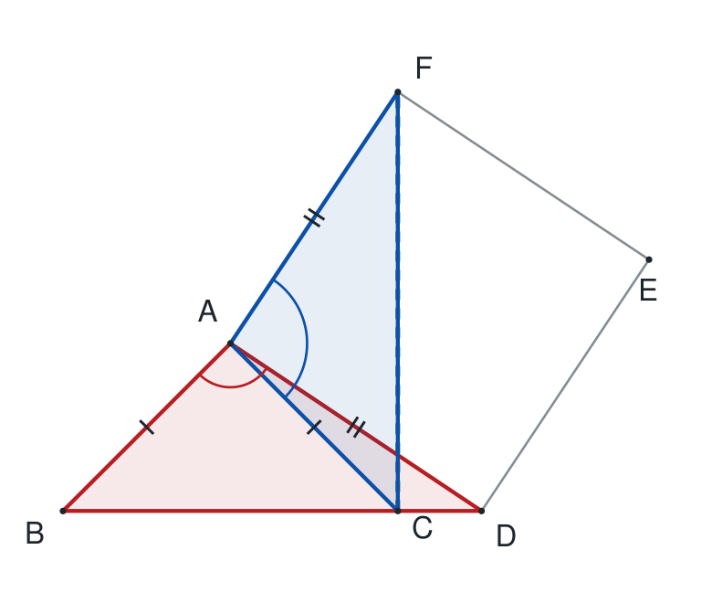

**作图：** D移到BC越过C的延长线上，仍比较同一组三角形。

AB=AC，AD=AF。

此时∠BAD=90°+∠CAD，

∠CAF=90°+∠CAD，两角仍相等。

△BAD≌△CAF（SAS），BD=CF。

现在B、C、D依次共线，BD=BC+CD。

**结论：** BC=CF-CD。

## 题2（1）：中点制造等腰三角形｜第1步：延长BF，把F变成第二条线段的中点

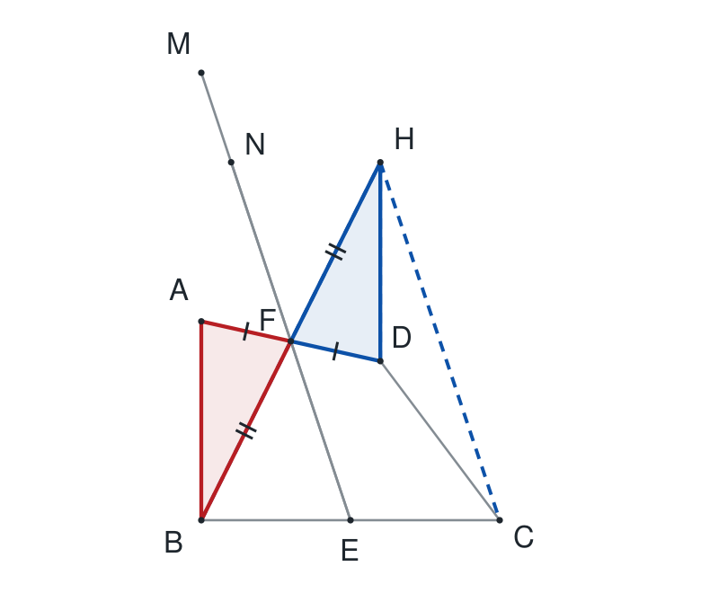

**作图：** 延长BF过F到H，使FH=FB；连接DH、CH。

AF=DF（原有中点）。

BF=FH（新构造）。

∠AFB=∠DFH（对顶角）。

所以△AFB≌△DFH（SAS）。

得到DH=AB，且由对应角得DH∥AB。

**结论：** DH=AB=CD，DH∥AB；F是BH中点。

## 题2（1）：中点制造等腰三角形｜第2步：中点给平行，等腰给等角

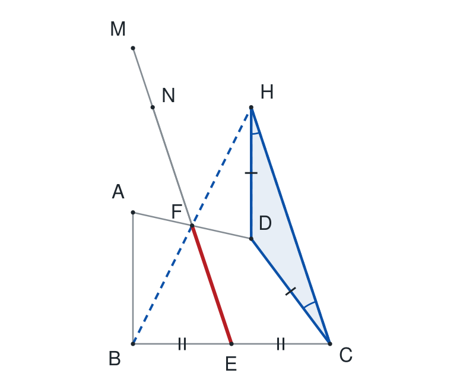

**作图：** 单独突出△BHC的中点连线EF和等腰△DHC。

在△BHC中，E是BC中点，F是BH中点，故EF∥CH。

DH=CD，所以△DHC为等腰三角形，∠DHC=∠DCH。

AB∥DH，EF∥CH，且C、D、N共线。

因此∠BME=∠DHC，∠CNE=∠DCH。

**结论：** ∠BME=∠CNE。

## 题2（2）：换位置，重新识别对应角｜第1步：把第（1）问的辅助构造迁移过来

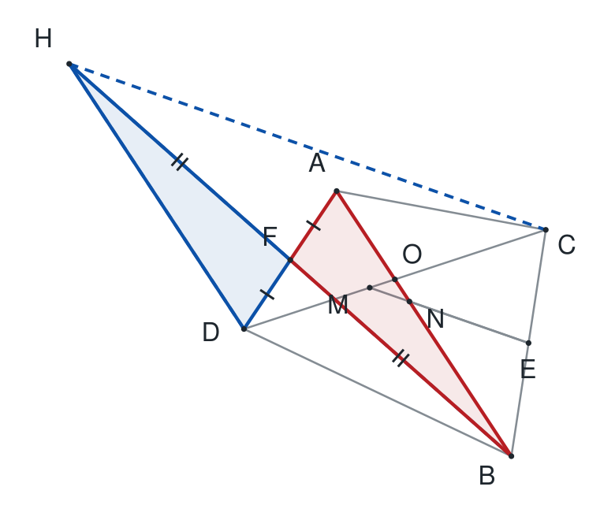

**作图：** 仍延长BF至H，使FH=FB；连接DH、CH。

原图位置变了，但AF=DF、BF=FH及对顶角仍成立。

所以△AFB≌△DFH（SAS），DH=AB=CD，DH∥AB。

E是BC中点，F是BH中点，仍有EF∥CH。

**结论：** △DHC等腰，且MN∥HC，AB∥DH。

## 题2（2）：换位置，重新识别对应角｜第2步：先找大三角形里的两个相等角

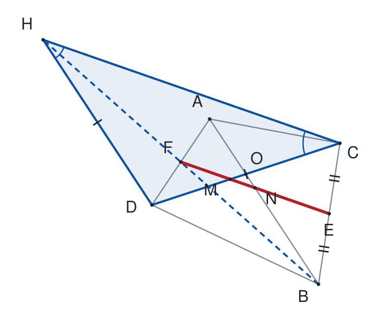

**作图：** 突出△DHC，并把MN所在直线与CH作对照。

DH=DC，所以∠DHC=∠DCH。

图b中O、N在直线AB上，O、M在直线CD上。

利用AB∥DH、MN∥HC，可将△OMN的两个底角分别对应到△DHC的两个底角。

**结论：** ∠OMN=∠DCH，∠ONM=∠DHC。

## 题2（2）：换位置，重新识别对应角｜第3步：放大看△OMN，写出形状

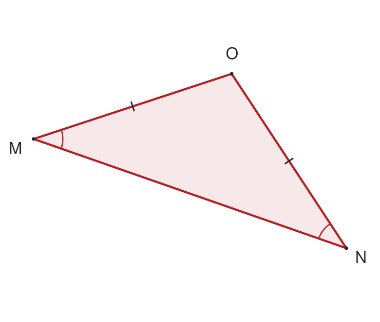

**作图：** 放大△OMN，标出M、N处的相等角。

∠OMN=∠DCH，

∠ONM=∠DHC。

而∠DCH=∠DHC，

所以∠OMN=∠ONM。

等角对等边，得到OM=ON。

**结论：** △OMN是等腰三角形，OM=ON；顶角度数不固定。

## 题2（3）：末问需要新的辅助点｜第1步：在CA延长线上复制CD

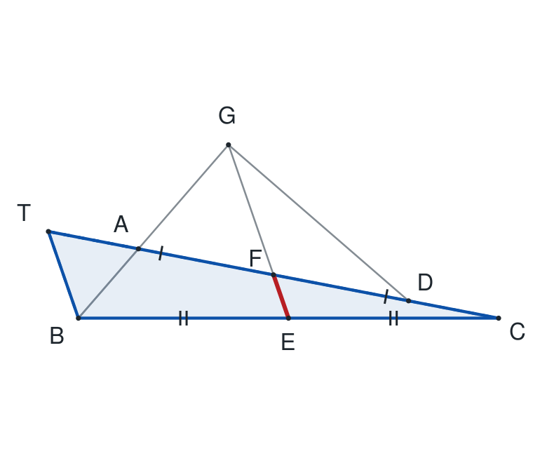

**作图：** 延长CA过A到T，使AT=CD（=AB），连接TB。

A、F、D、C依次共线，AF=FD。

TF=TA+AF；FC=FD+DC。

因为TA=DC，所以TF=FC，F恰为TC中点。

E是BC中点，于是△TBC中EF是中点连线，EF∥TB。

**结论：** 新的辅助点T使EF∥TB，且AT=AB。

## 题2（3）：末问需要新的辅助点｜第2步：60°条件使△TAB变为等边

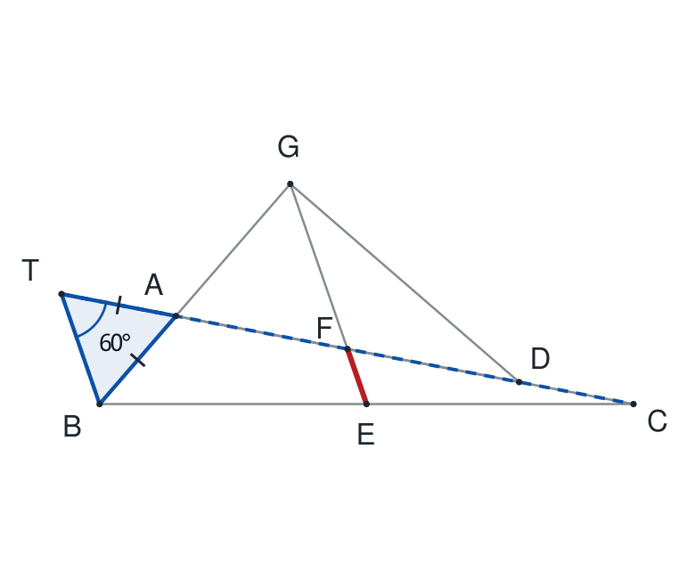

**作图：** 突出△TAB，用EF∥TB把60°搬到T。

EF∥TB，TA与FC同向共线，

所以∠BTA=∠EFC=60°。

又AT=AB，△TAB的两个底角相等，故∠TBA=60°。

第三个角∠TAB也为60°。

**结论：** △TAB为等边三角形，∠TAB=60°。

## 题2（3）：末问需要新的辅助点｜第3步：放大看△AGF，证明它是等边

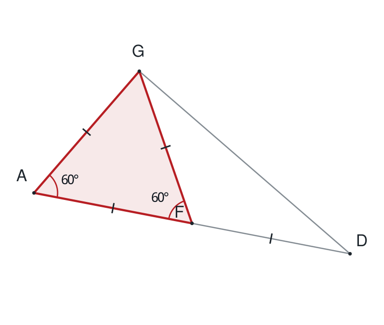

**作图：** 放大△AGF；沿用上一步G、A、B共线，T、A、F共线的关系。

∠GAF与∠TAB为对顶角，所以∠GAF=60°。

FG∥TB，射线FA与TA反向、射线FG与TB反向，故∠AFG=∠BTA=60°。

因此△AGF为等边三角形。

AF=FD（原有中点），于是GF=AF=FD。

**结论：** AG=GF=AF=FD，∠AGF=60°。

## 题2（3）：末问需要新的辅助点｜第4步：用120°与30°拼出直角

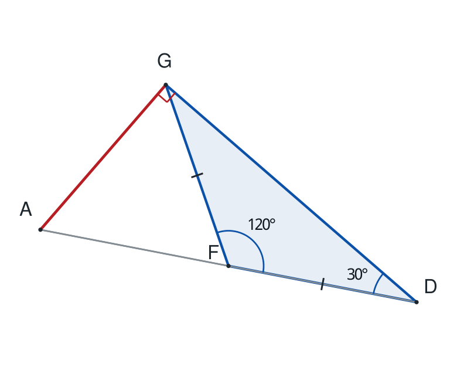

**作图：** 放大△AGD，突出等腰△GFD，在G处标直角。

FA、FD反向共线，

∠GFD=180°-∠GFA=120°。

GF=FD，所以∠FGD=∠FDG=30°。

F在AD上，故∠AGD=∠AGF+∠FGD=60°+30°=90°。

**结论：** △AGD为直角三角形，∠AGD=90°，∠ADG=30°。

## 中点连线平行性质：只用两次SAS

△TUV中，X、Y分别为TU、TV中点。延长XY至Z，使YZ=YX。由TY=YV、YX=YZ和对顶角，△TYX≌△VYZ（SAS），所以VZ=TX=UX，VZ∥UX。连接UZ。由UX=VZ、UZ公共和内错角，△XUZ≌△VZU（SAS），得XZ=VU，XZ∥VU，进而XY∥UV。所配逐步图见原教师图解附录（链接在README），可在课前补讲。

## 末问必须讲透的四个问题

①为什么在CA越过A的方向取T，而不是在AC越过C的方向？
②怎样从AT=CD和AF=FD推出TF=FC？
③哪一步用到了∠EFC=60°？
④为什么最后答案是G处直角，而不是把△AGD直接认成等边？

## 即时回练，不另编题

遮住教师答案，让学生只看图c，重新构造T、证明F是TC中点，并口述从平行线到60°、120°、30°、90°的完整链条。若讲解后能重建，记录为即时掌握；下一课还需陌生同型题检查迁移。

## 提示等级与记录

题1独立用时____分钟，____/12；题2____分钟，____/24。
辅助线：□独立想到 □口头方向 □给出辅助点 □完整示范。
中点性质：□已掌握 □需补讲。
末问卡在：□构造T □证明中点 □角度迁移 □特殊三角形 □合并角度。
