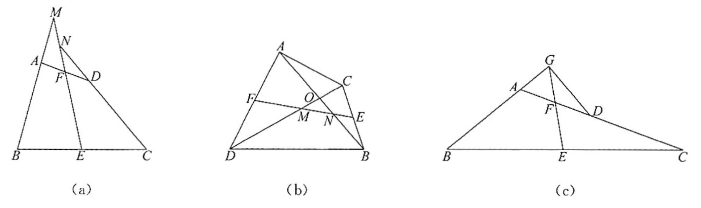
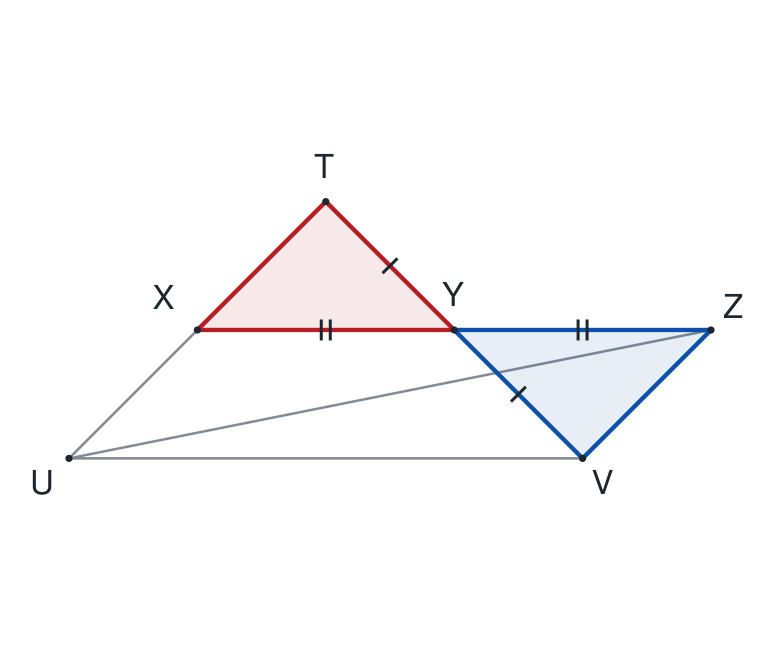
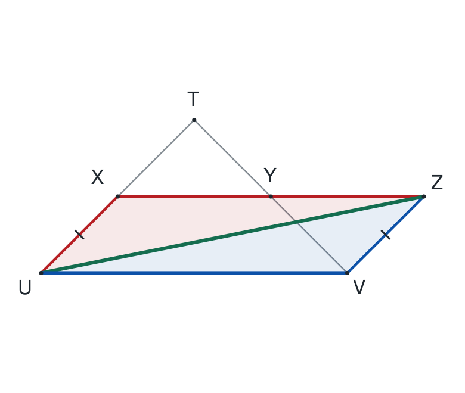
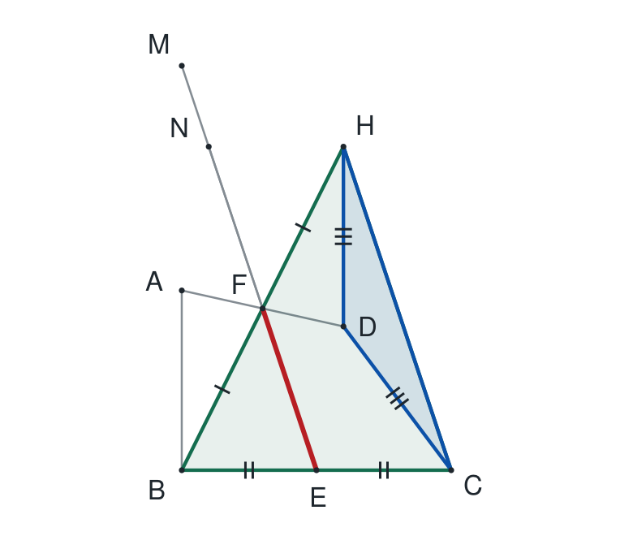
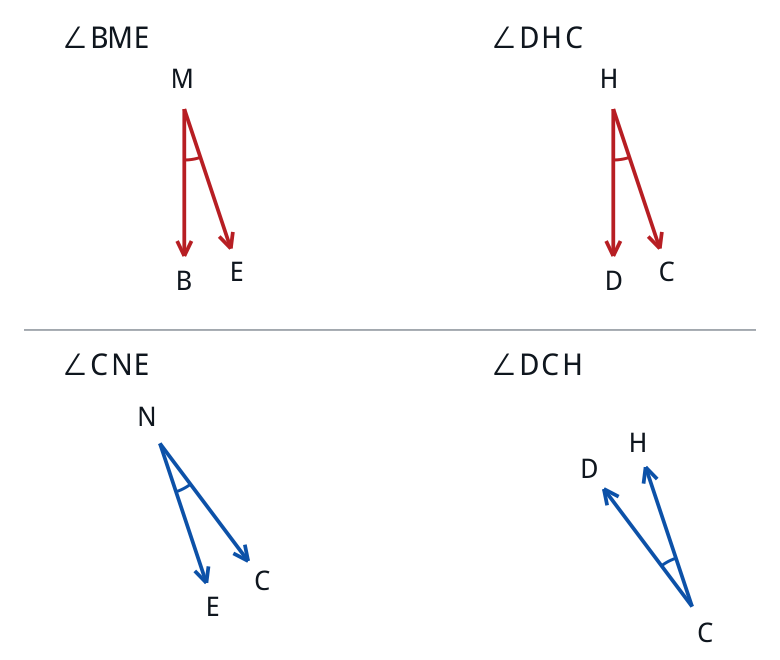
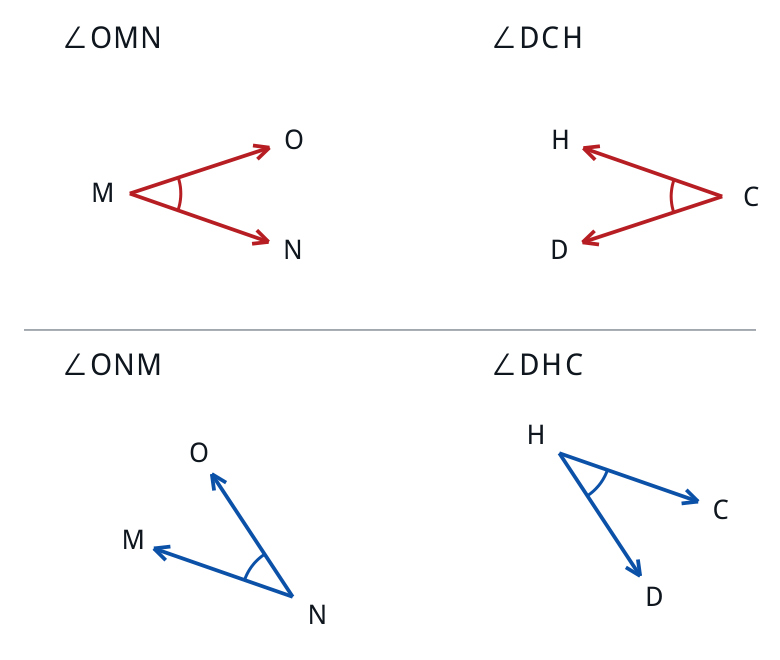
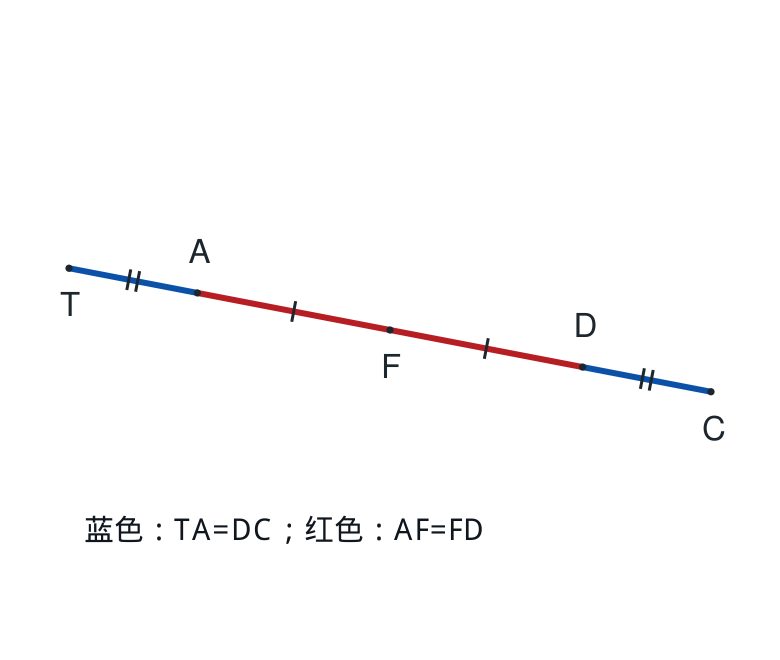
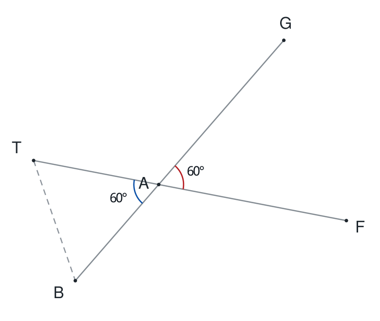
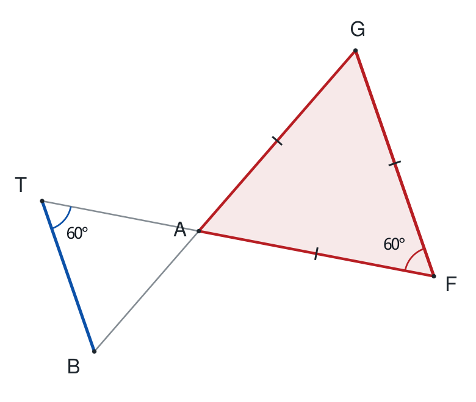

# 两道补充题：逐步配图教师详解

题目来源与编排说明见[README](README.md)。

## 本次修订了什么

原版把前两问的对应角、第三问的辅助点动机写得过快。本版把三问拆成12个图文步骤，并增加两页中点引理；一个关键结论占一页，射线方向和角的来源单独解释。学生题面、选题和分值保持一致。

## 两题的定位与安排

题1是中等题，建议10—12分钟；题2是综合压轴题，建议25—35分钟。两题独立完成约40—45分钟，再用约45分钟讲解，余下时间用于批改、追问和遮住答案后重建辅助线。

## 先备知识

全等SAS、平行线与角、等腰和等边三角形、中点。若中点连线性质尚未学，先看本版两页引理；证明只用两次SAS，无需相似、勾股定理或根式。

## 答案与评分

题1：（1）BC=CF+CD；（2）BC=CF-CD，各6分。题2：（1）∠BME=∠CNE，6分；（2）OM=ON，6分；（3）△AGD直角，直角在G，12分。第三问建议：构造T及中点4分、△TAB等边2分、△AGF等边2分、等腰角度与直角结论4分。

## 来源与文件

原题、原图与固定版本出处保留在README及sources。本版图形为独立教学重绘。除这份完整教师版，另提供只含三问压轴题的challenge_detailed.pdf、Word和在线图文版，便于手机阅读。

## 题1｜（1）旋转全等，再把BD拆成两段

由∠BAC=90°、∠ABC=45°，得AB=AC。
正方形给AD=AF、∠DAF=90°。
∠BAD=90°-∠DAC=∠CAF。
所以△BAD≌△CAF（SAS），BD=CF。
D在B、C之间，BC=BD+DC。

**结论：** BC=CF+CD。

## 题1｜（2）同样全等，点的位置改用减法

AB=AC，AD=AF。
此时∠BAD=90°+∠CAD，
∠CAF=90°+∠CAD，两角仍相等。
△BAD≌△CAF（SAS），BD=CF。
现在B、C、D依次共线，BD=BC+CD。

**结论：** BC=CF-CD。

## 三问压轴题｜完整题面

（1）如图a，在四边形ABCD中，AB=CD，E、F分别是BC、AD的中点。直线EF与BA、CD的延长线分别交于M、N。求证：∠BME=∠CNE。
（2）如图b，在四边形ADBC中，AB=CD，E、F分别是BC、AD的中点。AB与CD交于O，直线EF与DC、AB分别交于M、N，M、N、O互不重合。判断△OMN的形状，并证明。
（3）如图c，在△ABC中，AC>AB，D在AC上，且AB=CD。E、F分别为BC、AD的中点，直线EF与BA的延长线交于G。若∠EFC=60°，连接GD，判断△AGD的形状，并证明。

阅读顺序：未学中点连线性质先看两页引理；已学可直接从第（1）问开始。原题保持不变，下面重写完整解释。

## 先备知识｜引理第1步：把中点条件变成全等条件

**为什么这样想：** 后三问都要用“连接两边中点的线段平行于第三边”。若尚未学过，先用全等证明；本页和下一页合起来就是完整证明。

**看图／作图：** 在△TUV中，X、Y分别为TU、TV中点。延长XY过Y至Z，使YZ=YX；连接VZ、UZ。

① TY=YV（Y是TV中点），YX=YZ（作图）。

② ∠TYX=∠VYZ（对顶角）。

③ 所以△TYX≌△VYZ（SAS）。

④ 对应边相等，得TX=VZ；又TX=XU，故XU=VZ。

⑤ 对应角∠TXY=∠VZY；它们是内错角，故TX∥VZ。

⑥ T、X、U共线，因此XU∥VZ。

**本页结论：** 得到一组平行且相等的线段：XU∥VZ，XU=VZ。

**讲解提醒：** 本页只做准备：还没有证明XY∥UV，要继续看第二次全等。

## 先备知识｜引理第2步：再用一次SAS，得到平行

**为什么这样想：** 上页已把XU与VZ变成平行且相等的一组边。连接UZ后，再比较共用UZ的两个三角形。

**看图／作图：** 突出△XUZ、△VZU；UZ是公共边。

① XU=VZ（上页），UZ=ZU（公共边）。

② XU∥VZ，故∠XUZ=∠VZU（内错角）。

③ 所以△XUZ≌△VZU（SAS）。

④ 得∠XZU=∠VUZ（对应角）。

⑤ 这两个角是直线XZ、UV被UZ所截的内错角，故XZ∥UV。

⑥ X、Y、Z共线，所以XY∥UV。

**本页结论：** 三角形两边中点的连线平行于第三边；下文简称“中点连线性质”。

**讲解提醒：** 对应到后文：先找到一个三角形，再说明两个点分别是哪两条边的中点。

## 第（1）问｜第1步：为什么要倍长BF？

**为什么这样想：** AB=CD，但这两条边还没在同一个三角形里。想把AB复制到D处；F又是AD中点，所以尝试以F为中心作一组全等三角形。

**看图／作图：** 连接BF，延长BF过F至H，使FH=FB；连接DH、CH。

① AF=DF（F是AD中点），BF=FH（作图）。

② A、F、D共线，B、F、H共线，故∠AFB=∠DFH。

③ △AFB≌△DFH（SAS），对应为A↔D、F↔F、B↔H。

④ 所以DH=AB；结合AB=CD，得DH=CD。

⑤ 还得到∠ABF=∠DHF（对应角）。

⑥ 这是一组内错角，故AB∥DH。

**本页结论：** DH=CD，AB∥DH；同时B、F、H共线且BF=FH。

**讲解提醒：** 辅助点H做了两件事：复制AB，并让F成为BH的中点。

## 第（1）问｜第2步：两个中点落在哪个三角形里？

**为什么这样想：** E原本就是BC中点；上一步又得到F是BH中点。两条线段BC、BH共同属于△BHC，所以应当看这个大三角形。

**看图／作图：** 突出△BHC及其中的EF；另用蓝色突出等腰△DHC。

① 在△BHC中，BE=EC，故E是BC中点。

② B、F、H共线且BF=FH，故F是BH中点。

③ 由中点连线性质，EF∥CH。

④ 由上页DH=CD，△DHC是等腰三角形，底边为HC。

⑤ 因而两个底角相等：∠DHC=∠DCH。

⑥ 现在已知AB∥DH、EF∥CH，下一步把目标角对应过来。

**本页结论：** 先在等腰△DHC中得到∠DHC=∠DCH，再去找原题的角。

**讲解提醒：** 等腰三角形的顶点是D，两个相等的角在H、C。

## 第（1）问｜第3步：把两组对应角分别画出来

**为什么这样想：** “两组线分别平行”本身还不够，角也可能互补。要检查组成角的两条射线是同向还是反向；两条射线同时反向，角度保持不变。

**看图／作图：** 上排对照M、H处的角；下排对照N、C处的角。箭头表示射线方向，同色弧表示待比较的角。

① 在图a的位置中，射线MB与HD平行且同向，ME与HC也平行且同向。

   所以∠BME=∠DHC（上排两个角）。

② 射线NC与CD平行且反向，NE与CH也平行且反向。

   相当于把整个角转过180°，所以∠CNE=∠DCH（下排两个角）。

③ 上页已证∠DHC=∠DCH。

④ 连起来：∠BME=∠DHC=∠DCH=∠CNE。

**本页结论：** ∠BME=∠CNE，第（1）问得证。

**讲解提醒：** 不能把“CD与NC共线”直接写成同向；这里它们实际反向。

## 第（2）问｜第1步：位置变了，哪些结论仍成立？

**为什么这样想：** 第（1）问的构造只用到中点和全等，换成图b仍可使用。先重新列出理由，再辨认目标三角形的位置。

**看图／作图：** 仍延长BF过F至H，使FH=FB；连接DH、CH。

① AF=DF、BF=FH，且∠AFB=∠DFH。

② △AFB≌△DFH（SAS），得DH=AB=CD。

③ ∠ABF=∠DHF（对应角），内错角相等，故AB∥DH。

④ 在△BHC中，E是BC中点，F是BH中点，故EF∥CH。

⑤ M、N、E、F共线，所以MN∥CH。

⑥ DH=CD，所以∠DHC=∠DCH。

**本页结论：** 仍有等腰△DHC、MN∥CH、AB∥DH。

**讲解提醒：** O是AB与CD交点；M、N是EF分别与CD、AB的交点。不要把交点认反。

## 第（2）问｜第2步：小三角形的底角对应哪里？

**为什么这样想：** 原图的△OMN很小，容易看错。这里把M、N处的角拆开画，并与等腰△DHC的两个底角分别比较。

**看图／作图：** 上排比较∠OMN与∠DCH；下排比较∠ONM与∠DHC。

① 射线MO与CD平行且反向，MN与CH也平行且反向。

   两条射线同时反向，故∠OMN=∠DCH。

② 射线NO与HD平行且反向，NM与HC也平行且反向。

   两条射线同时反向，故∠ONM=∠DHC。

③ 等腰△DHC给出∠DCH=∠DHC。

④ 所以∠OMN=∠ONM，即△OMN的M、N两角相等。

**本页结论：** 相等的是M、N处的两个角；下一页由等角判断等边。

**讲解提醒：** 这些射线方向按图b所示位置判断；角的拆图保留了原图的方向。

## 第（2）问｜第3步：由两个相等角，写出形状

**为什么这样想：** 已经得到M、N处角相等，形状判断只需再用“等角对等边”。此时应单独看△OMN。

**看图／作图：** 放大△OMN，标出相等的底角及其所对的边。

① ∠OMN=∠ONM（上页）。

② ∠OMN所对的边是ON，∠ONM所对的边是OM。

③ 在同一个三角形中，等角对等边，所以ON=OM。

④ 故△OMN是以O为顶点、MN为底边的等腰三角形。

**本页结论：** △OMN是等腰三角形，OM=ON。

**讲解提醒：** 条件不能确定O处角度；这里没有理由进一步断言它是直角三角形。

## 第（3）问｜第1步：辅助点T是怎样反推出来的？

**为什么这样想：** E是BC中点。若想让EF平行于某条新边TB，就应让F成为TC的中点。因此先反推：怎样取T才能使TF=FC？

**看图／作图：** 延长CA过A至T，使AT=CD（也等于AB）；本页先只看这条直线上的长度。

① A、F、D、C依次共线，AF=FD（F是AD中点）。

② 若T放在A外侧，则TF=TA+AF，而FC=FD+DC。

③ 因为AF=FD，只要取TA=DC，就能使上述两段相等。

④ 因此作T，使AT=CD。再用CD=AB，得AT=AB。

⑤ 此时T、A、F、D、C依次共线，

   TF=TA+AF=DC+FD=FC，所以F是TC的中点。

**本页结论：** 取T的目的：把“F是AD中点”变成“F也是TC中点”；同时得到AT=AB。

**讲解提醒：** T不是凭空猜出来的：先想要TF=FC，再倒推应取TA=DC。

## 第（3）问｜第2步：60°先使哪个三角形等边？

**为什么这样想：** 现在E、F已成为△TBC两边的中点。先得到EF∥TB，把已知60°转移到T处；AT=AB便能接着发挥作用。

**看图／作图：** 连接TB，突出△TAB，标出T处与F处对应的60°。

① 在△TBC中，E是BC中点，F是TC中点，故EF∥TB。

② 直线TC为截线，∠BTA与∠EFC为同位角。

   因而∠BTA=∠EFC=60°。

③ AT=AB，故△TAB中∠TBA=∠BTA=60°。

④ 由三角形内角和，∠TAB=180°-60°-60°=60°。

⑤ 三个角都为60°，所以△TAB是等边三角形。

**本页结论：** △TAB等边，∠TAB=∠BTA=∠TBA=60°，且EF∥TB。

**讲解提醒：** 已知的60°是∠EFC；这里必须先证EF∥TB，才可以把它搬到T。

## 第（3）问｜第3步：A处的60°怎样得到？

**为什么这样想：** 最终要看△AGD，而△TAB在另一侧。先利用A点两条交叉的直线，把等边△TAB的60°转到△AGF中。

**看图／作图：** 单独画出G—A—B与T—A—F两条相交直线；同色弧标出一对对顶角。

① G在BA越过A的延长线上，所以G、A、B依次共线。

② T在CA越过A的延长线上，且F在AC上，所以T、A、F依次共线。

③ 因而射线AG与AB反向，射线AF与AT反向。

④ ∠GAF与∠TAB是一对对顶角，大小相等。

⑤ 上页得到∠TAB=60°，故∠GAF=60°。

**本页结论：** △AGF在A处的角为60°；还需再确定它的另一个角。

**讲解提醒：** 请先在图上指出组成∠TAB的两条射线，再找各自的反向射线。

## 第（3）问｜第4步：F处再得60°，得到第二个等边三角形

**为什么这样想：** 只知道一个60°还不能认定等边。利用GF所在直线与TB平行，再得到F处的60°，才能推出GF=AF。

**看图／作图：** 突出平行的TB、FG，以及截线TC；比较T处和F处的一组内错角。

① G、F、E共线，且EF∥TB，所以FG∥TB。

② 直线TC截平行线TB、FG，∠BTA与∠AFG是一组内错角。

   因而∠AFG=∠BTA=60°。

③ 上页已得∠GAF=60°，所以∠AGF=180°-60°-60°=60°。

④ △AGF三个角均为60°，故为等边三角形，AG=GF=AF。

⑤ 原题F是AD中点，AF=FD，所以GF=FD。

**本页结论：** △AGF等边；尤其GF=AF=FD，这是下一步判断等腰的依据。

**讲解提醒：** F处的60°是∠AFG；相邻的∠GFD还没有算，它不是60°。

## 第（3）问｜第5步：为什么会出现120°和30°？

**为什么这样想：** F在AD上，FA与FD方向相反。因此等边△AGF的60°旁边，恰好是一个120°；再利用GF=FD求出两个底角。

**看图／作图：** 单独放大△GFD，保留A以便看清FA、FD是两条反向射线。

① A、F、D依次共线，故∠GFA+∠GFD=180°（平角）。

② △AGF等边，∠GFA=60°，所以∠GFD=120°。

③ 上页GF=FD，故△GFD是等腰三角形，顶点为F。

④ ∠FGD=∠FDG=(180°-120°)÷2=30°。

⑤ A、F均在D的同侧，且三点共线，所以射线DF与DA重合，

   因而∠ADG=∠FDG=30°。

**本页结论：** △GFD中：F处120°，G、D处各30°；△AGD在D处也是30°。

**讲解提醒：** 相等边GF、FD的公共端点是F，所以120°是顶角，两个30°是底角。

## 第（3）问｜第6步：哪个角是直角？把它拼出来

**为什么这样想：** 要求判断的是△AGD。前面得到的等边△AGF、等腰△GFD只是中间结构，最后必须回到G点把相邻的两个角相加。

**看图／作图：** 突出整个△AGD，用GF把G处的角分成60°与30°两部分，再标出总直角。

① 在△AGF中，∠AGF=60°；在△GFD中，∠FGD=30°。

② F在线段AD上，所以射线GF在∠AGD内部。

③ ∠AGD=∠AGF+∠FGD=60°+30°=90°。

④ 因而△AGD是直角三角形，直角顶点为G。

⑤ 另有∠ADG=30°、∠GAD=60°。

⑥ 还可由AD=AF+FD=2AF=2AG，得到AD=2AG。

**本页结论：** 最终答案：△AGD是直角三角形，∠AGD=90°，∠ADG=30°。

**讲解提醒：** 不要把两个中间结论混起来：△AGF等边、△GFD等腰、△AGD直角。

## 三问复盘与教师追问

### 第（1）问：从全等到等角

倍长BF至H → △AFB≌△DFH → DH=CD且AB∥DH → 在△BHC中得EF∥CH → △DHC等腰 → 分别对应M、N处的角 → ∠BME=∠CNE。

### 第（2）问：同一构造，重新辨认角

仍倍长BF至H → DH=CD、AB∥DH、MN∥CH → ∠OMN=∠DCH、∠ONM=∠DHC → M、N两角相等 → OM=ON。只能确定等腰。

### 第（3）问：三个三角形，各有不同作用

反推TF=FC，取TA=DC → EF∥TB → △TAB等边 → 对顶角和内错角使△AGF等边 → GF=AF=FD → △GFD等腰，得120°及两个30° → 在G处相加60°+30°，所以△AGD直角。

### 教师追问及可核对的回答

问：为什么T在A外侧？答：这样TF=TA+AF，能与FC=FD+DC逐项比较，取TA=DC即可。

问：为何不能见60°就认等边？答：必须再用等腰条件或求出第二个60°。

问：GF=FD从哪来？答：△AGF等边给GF=AF，原中点给AF=FD。

问：直角在哪里？答：G处，因为∠AGD=∠AGF+∠FGD=60°+30°。

### 讲课时的用法

先让学生在原图上指出对应的三角形、边、角，再展示下一页。讲后遮住详解，要求学生重画H或T并复述每一个等号的理由。已经会的页可以跳过，无须把整份详解当作逐字朗读稿。
