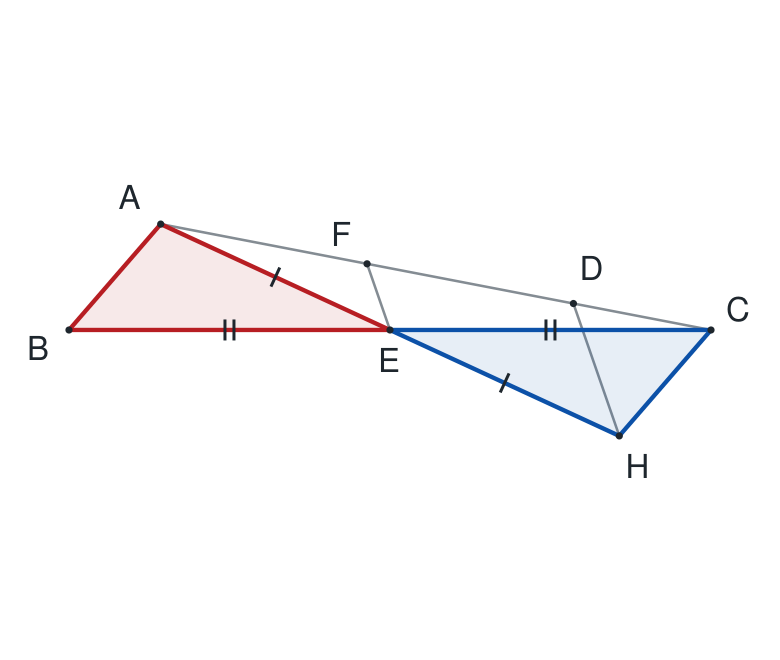
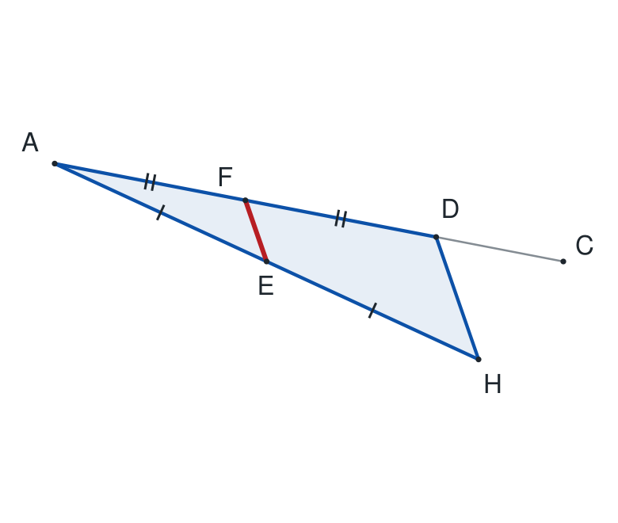
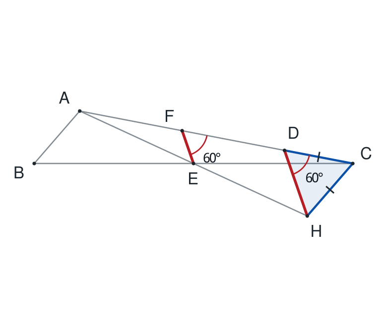
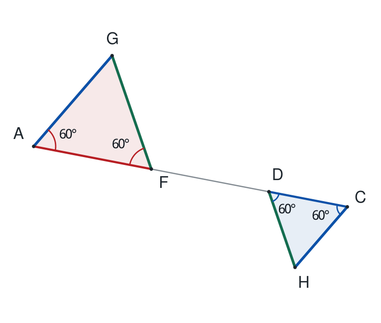
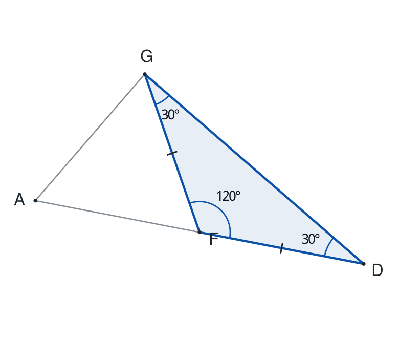
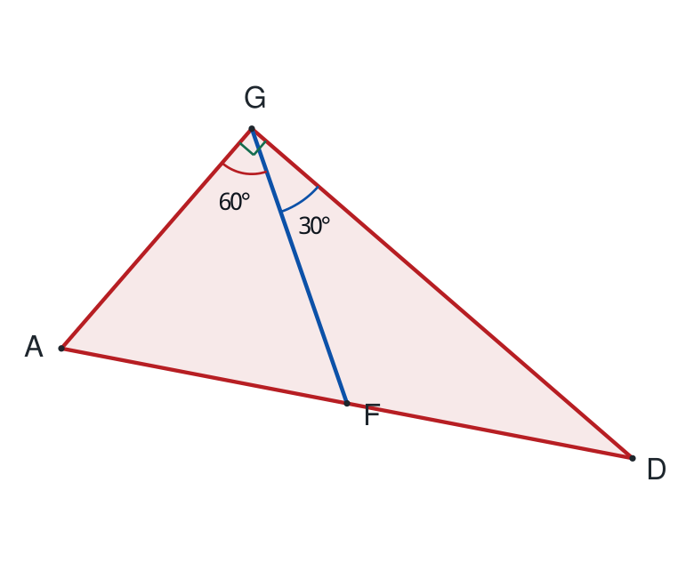

# 第（3）问：倍长AE法

这条辅助线思路由用户提出。延长AE过E至H，使EH=EA；H按本问重新定义。T点法仍可使用，但不是必须的选法。

如图c，在△ABC中，AC>AB，D在AC上，且AB=CD。E、F分别为BC、AD的中点，直线EF与BA的延长线交于G。若∠EFC=60°，连接GD，判断△AGD的形状，并证明。

连接△DHC与△AGD的关键中间结构是△AGF：先证它等边，得到GF=AF=FD，再利用等腰△GFD。

## 第1步：倍长AE，先把AB复制到CH

**为什么这样想：** 沿用“倍长中线、构造全等”的方法。E是BC中点；连接AE并倍长后，能把AB复制到C处，与原有的CD比较。

**作图／看图：** 连接AE，延长AE过E至H，使EH=EA；连接CH、DH。本问H按这个作法重新定义。

① AE=EH（作图），BE=EC（E是BC中点）。

② A、E、H共线，B、E、C共线，故∠AEB=∠HEC（对顶角）。

③ 所以△AEB≌△HEC（SAS），对应为A↔H、E↔E、B↔C。

④ 得CH=AB；结合AB=CD，得CH=CD。

⑤ 还得∠ABE=∠HCE（对应角）。

⑥ 这两个角是一组内错角，故AB∥CH。

**结论：** CH=CD，AB∥CH；E既是BC中点，也是AH中点。

## 第2步：在哪个三角形里得到EF∥DH？

**为什么这样想：** F是AD中点；倍长AE又让E成为AH中点。于是这两个中点落在△ADH的两条边上，正好能把EF与DH联系起来。

**作图／看图：** 突出△ADH：E在AH上、F在AD上，连接两个中点得到EF。

① 在△ADH中，AF=FD，所以F是AD中点。

② A、E、H共线且AE=EH，所以E是AH中点。

③ 由中点连线性质，EF∥DH。

④ 又G、F、E共线，因此GF∥DH。

⑤ 连同上页AB∥CH及G、A、B共线，还得到AG∥CH。

**结论：** 两组关键平行：GF∥DH，AG∥CH。它们正是通向△AGD的桥梁。

## 第3步：严格证明你找到的△DHC等边

**为什么这样想：** 上面已经得到CH=CD。再把∠EFC=60°移到D处，就能确定等腰△DHC的两个底角，从而得到等边。

**作图／看图：** 突出△DHC，并比较F处∠EFC与D处∠CDH。

① EF∥DH，且FC与DC在同一直线上、方向相同。

② ∠CDH与∠EFC是同位角，所以∠CDH=60°。

③ CH=CD，因此△DHC是等腰三角形，底边是DH。

④ ∠DHC=∠CDH=60°（等边对等角）。

⑤ ∠HCD=180°-60°-60°=60°，故△DHC是等边三角形。

**结论：** △DHC等边。相等边CH、CD的公共顶点是C，底角在D、H。

## 第4步：从△DHC转到△AGF，是关键的一步

**为什么这样想：** △AGD暂时缺少边长关系。但F是AD中点，只要先证明△AGF等边，就能得到GF=AF=FD，再使用等腰△GFD。

**作图／看图：** 上方突出△AGF，下方突出△DHC；A、F、D、C共线，两组斜边分别平行。

① AG∥CH；AG与CH反向，AF与CD也反向。

   两条射线同时反向，所以∠GAF=∠HCD=60°。

② GF∥DH；FA与DC反向，FG与DH也反向。

   所以∠AFG=∠CDH=60°。

③ △AGF的第三个角∠AGF=180°-60°-60°=60°。

④ 因而△AGF等边，得到AG=GF=AF。

⑤ 原题AF=FD，所以GF=FD。

**结论：** 由等边△DHC的角，得到等边△AGF，再得到GF=FD。

## 第5步：为什么会出现120°和30°？

**为什么这样想：** F在AD上，FA与FD方向相反。因此等边△AGF的60°旁边，恰好是一个120°；再利用GF=FD求出两个底角。

**作图／看图：** 单独放大△GFD，保留A以便看清FA、FD是两条反向射线。

① A、F、D依次共线，故∠GFA+∠GFD=180°（平角）。

② △AGF等边，∠GFA=60°，所以∠GFD=120°。

③ 上页GF=FD，故△GFD是等腰三角形，顶点为F。

④ ∠FGD=∠FDG=(180°-120°)÷2=30°。

⑤ A、F均在D的同侧，且三点共线，所以射线DF与DA重合，

   因而∠ADG=∠FDG=30°。

**结论：** △GFD中：F处120°，G、D处各30°；△AGD在D处也是30°。

## 第6步：哪个角是直角？把它拼出来

**为什么这样想：** 要求判断的是△AGD。前面得到的等边△AGF、等腰△GFD只是中间结构，最后必须回到G点把相邻的两个角相加。

**作图／看图：** 突出整个△AGD，用GF把G处的角分成60°与30°两部分，再标出总直角。

① 在△AGF中，∠AGF=60°；在△GFD中，∠FGD=30°。

② F在线段AD上，所以射线GF在∠AGD内部。

③ ∠AGD=∠AGF+∠FGD=60°+30°=90°。

④ 因而△AGD是直角三角形，直角顶点为G。

⑤ 另有∠ADG=30°、∠GAD=60°。

⑥ 还可由AD=AF+FD=2AF=2AG，得到AD=2AG。

**结论：** 最终答案：△AGD是直角三角形，∠AGD=90°，∠ADG=30°。
