# 教师答案：逐步配图与辅助线

2026-10-13更新。原题出处与原图见[README](README.md)。教学图为独立重绘，辅助线与结论按步骤呈现。

## 选题目的

针对原卷选择第10题、填空第16题及第24、25题的失分，主要检测旋转后的长度转移、中点辅助线、位置变化时的分类，以及最值的取等条件。题目选自现成资料，保留原条件、数值和原图；60分评分、时间、作答要求及以下讲解为本次编排。

## 难度与进度

这是一套提高诊断卷，不是基础题检测。第1题需要把三段长度转成一条折线；第2题需要主动补一个固定等边三角形；第3题需两次全等并在延长线位置重新判断加减；第4题需连接中点性质、旋转和面积。不要把“中考题”标签当作难度保证，重在是否独立完成这些方法链。

## 先备知识

只用全等、角关系、等边三角形、平行线、三角形不等式与面积公式完成主要推理。正方形只需四边相等、四角直角。中点连线性质若尚未学习，可用附录的两次SAS证明；记录为先备知识缺口，不直接判断为思维薄弱。第1题的根式数值另需勾股定理，不计本次评分。

## 120分钟安排

0—5分钟交代规则并确认先备知识；5—55分钟独立完成主卷；55—65分钟批改并追问卡点；65—105分钟讲解两条主要方法链；105—117分钟遮住原解，独立重建关键证明；117—120分钟让孩子复述方法并记录下一课目标。

## 讲解取舍

若第1、2题较弱：18分钟讲“旋转搬长度+等号条件”，18分钟讲“固定图形+中点轨迹”，4分钟复述。若小题完成较好：18分钟讲第3题两次全等及延长线加减，18分钟讲第4题旋转+中点+面积，4分钟复述。若中点性质不会，先用8分钟补引理，余下32分钟只精讲一个核心大题。

## 使用边界

原卷已被学校讲评，做过同型题不等于掌握。这次优先观察辅助线是否自己想到、夹角能否说明，以及最值能否证明取得。50分钟结束可保留未完成，不用把60分线性换算成150分预测成绩。

## 第1题：旋转与三段距离最小值

### 第1步：把AM换成EN

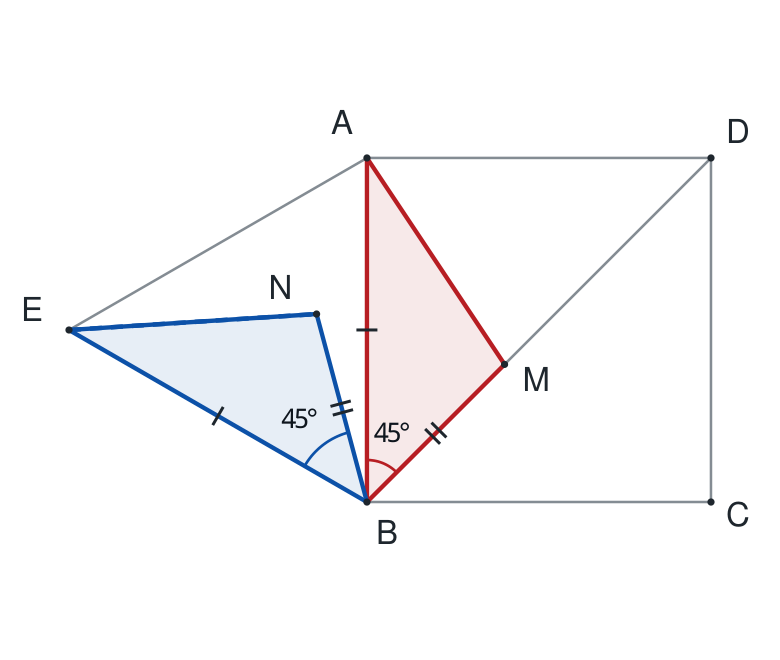

**作图：** 连EN，突出△ABM和△EBN。

①BA=BE（等边△ABE）。

②BM=BN（旋转得到）。

③∠ABM=∠EBN=45°。

所以△ABM≌△EBN（SAS）。对应顶点是A与E、B与B、M与N。

**本步结论：** 对应边：AM=EN。

### 第2步：把BM换成MN

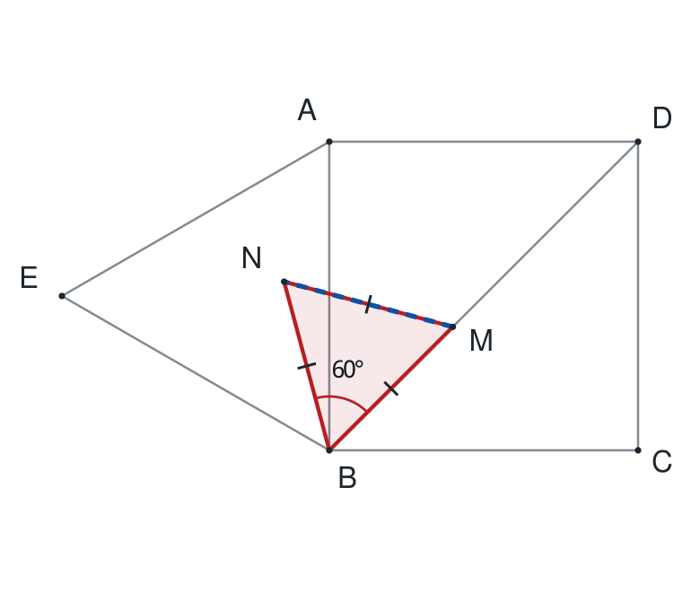

**作图：** 连MN，单独看△BMN。

①BM=BN。

②∠MBN=60°。

等腰三角形的两个底角均为(180°-60°)/2=60°。

因此△BMN是等边三角形。

**本步结论：** BM=MN；此时三段距离成为EN、NM、MC。

### 第3步：把长度和写成折线路径

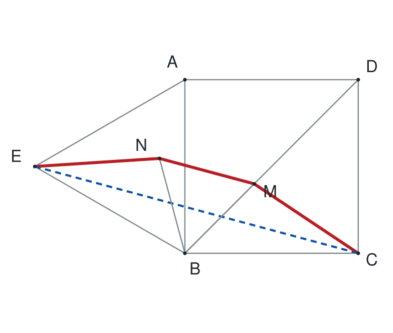

**作图：** 蓝色虚线EC是固定线段；红色EN、NM、MC是折线。

AM+BM+CM

=EN+NM+MC

≥EC。

依据：两点之间线段最短。这里只找到了下界，还必须证明等号能取到。若M=B，三段和为4，且EC<BE+BC=4。

**本步结论：** 任何允许的M，都有AM+BM+CM≥EC。

### 第4步：画出取得最小值的位置

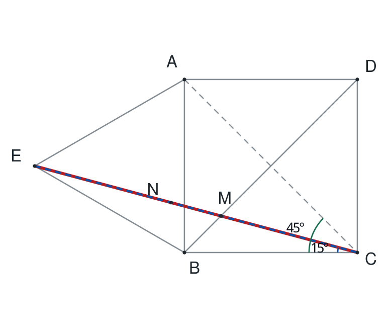

**作图：** 取M为EC与BD的交点，再得到N；补画AC确认取点范围。

BE=BC，∠EBC=150°，所以∠ECB=15°。

∠BCA=45°，CE进入△ABC内部，故与BD相交于BD内部。

BD与BC夹45°；由等边△BMN，MN与BC夹15°，所以MN∥EC。

当M在EC上时，E、N、M、C依次共线，等号成立。

**本步结论：** 等号可取得；最小值为CE，M=EC与BD的交点。

### 第5步：数值计算（未学勾股可跳过）

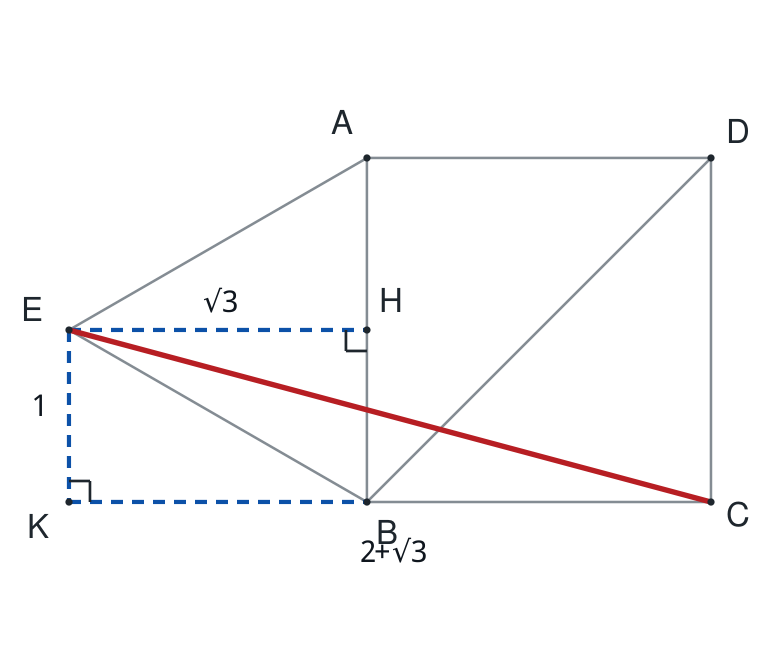

**作图：** 作EH⊥AB于H；作EK⊥BC所在直线于K。

等边△ABE边长2，H为AB中点，所以BH=1。

EH²=2²-1²=3，EH=√3。

EK=BH=1，KC=KB+BC=√3+2。

CE²=EK²+KC²=8+4√3。

**本步结论：** CE=√6+√2。主要诊断评分可只要求“最小值为CE”。

## 第2题：等边动点与中点轨迹

### 第1步：补一个不会动的等边三角形

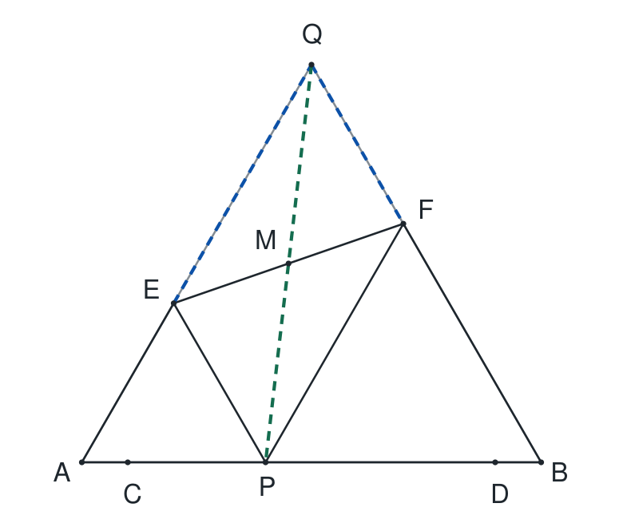

**作图：** 在AB同侧作等边△ABQ，Q是固定点；连QP。

∠EAP=∠QAB=60°，所以A、E、Q共线。

同理B、F、Q共线。

E、F随P运动，但Q不动。

后面要把M的运动转化成“固定点Q与动点P之间的中点运动”。

**本步结论：** 固定辅助点：Q；E在AQ上，F在BQ上。

### 第2步：找到一组等长且平行的边

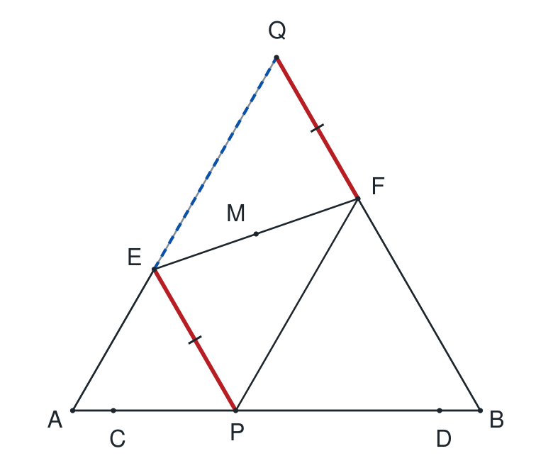

**作图：** 突出EP和FQ；二者都沿等边三角形的同一边方向。

由两个等边三角形的60°角，EP∥BQ，因此EP∥FQ。

EP=AP，BF=BP，BQ=AB。

FQ=BQ-BF=AB-BP=AP。

**本步结论：** EP=FQ，EP∥FQ。

### 第3步：证明M也恰好是QP中点

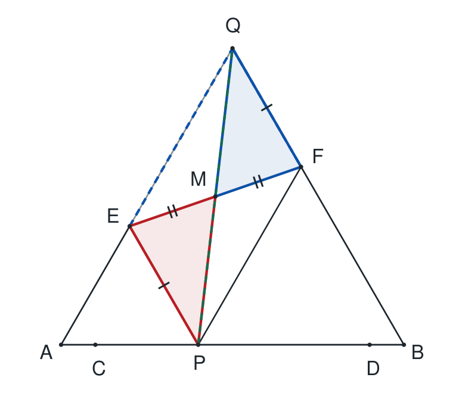

**作图：** 连PM、QM，突出△PEM和△QFM。

①EM=FM（M为EF中点）。

②EP=FQ（第2步）。

③∠PEM=∠QFM（平行线）。

所以△PEM≌△QFM（SAS），PM=QM。P、Q在EF两侧，且∠EMP=∠FMQ、EM与FM反向共线，故MP、MQ也反向共线。

**本步结论：** Q、M、P共线且QM=MP，M是QP中点。

### 第4步：证明M走的是固定直线

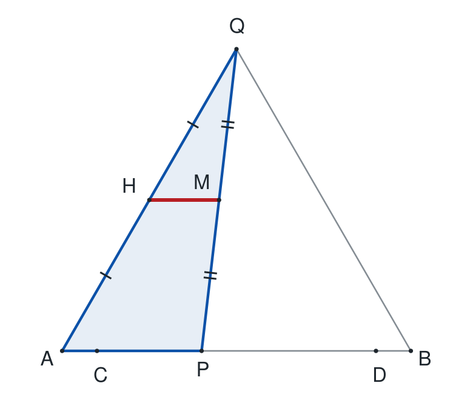

**作图：** 取QA中点H，连HM；单独看△QAP。

H为QA中点，M为QP中点。

由中点连线性质，HM∥AP。

A、P都在固定直线AB上，所以HM始终平行AB。H也固定，因此M始终在过H且平行AB的同一条直线上。

**本步结论：** M沿固定直线运动，不是曲线；未学中点性质先看附录。

### 第5步：定位起点终点，再算路径长

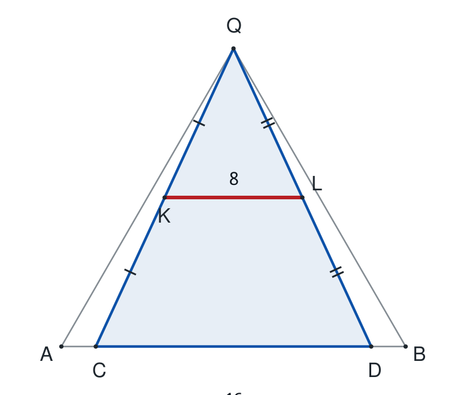

**作图：** 取QC、QD的中点K、L，连KL。

P=C时，M=K；P=D时，M=L。

在△QCD中，KL是中点连线。

CD=AB-AC-BD=20-2-2=16。

KL=CD/2=8。P单向从C到D，M也单向从K到L。

**本步结论：** M的运动路径是线段KL，路径长8。

## 第3题：基本图、一般图和延长线变式

### （1）第1步：在B外侧复制DF

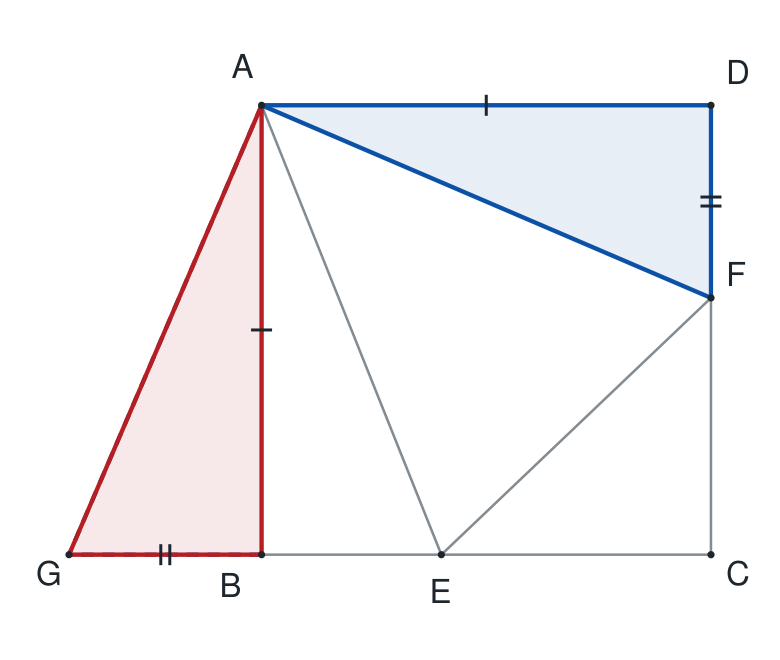

**作图：** 延长CB到G，使BG=DF，连AG。

正方形给AB=AD，∠ABG=∠ADF=90°。

再加BG=DF，得到

△ABG≌△ADF（SAS）。

所以AG=AF，∠BAG=∠DAF。

**本步结论：** 第一次全等得到：AG=AF，以及一组对应角相等。

### （1）第2步：第二次全等，得到加法关系

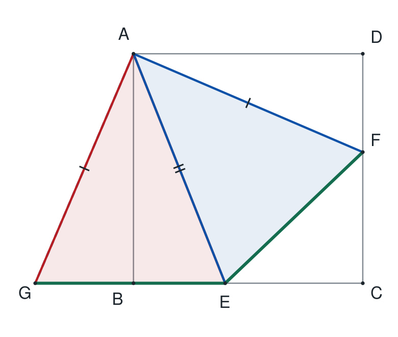

**作图：** 突出△GAE和△FAE；红绿线段GE由GB与BE组成。

∠GAE=∠BAG+∠BAE

=∠DAF+∠BAE

=90°-45°=45°=∠EAF。

AG=AF，AE公共，所以△GAE≌△FAE（SAS），GE=FE。

G、B、E依次共线，GE=GB+BE。

**本步结论：** EF=GE=GB+BE=DF+BE。

### （2）第1步：一般四边形中仍复制DF

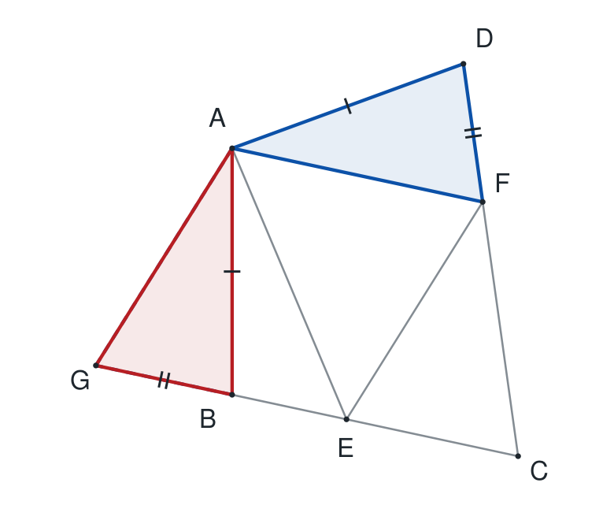

**作图：** 仍延长CB到G，使BG=DF，连AG。

AB=AD。

∠ABG=180°-∠ABC。

已知∠ABC+∠ADC=180°，所以∠ABG=∠ADC=∠ADF。

结合BG=DF，得到△ABG≌△ADF（SAS）。

**本步结论：** 仍有AG=AF，∠BAG=∠DAF；不需要四个角都为90°。

### （2）第2步：用“半角”替代45°

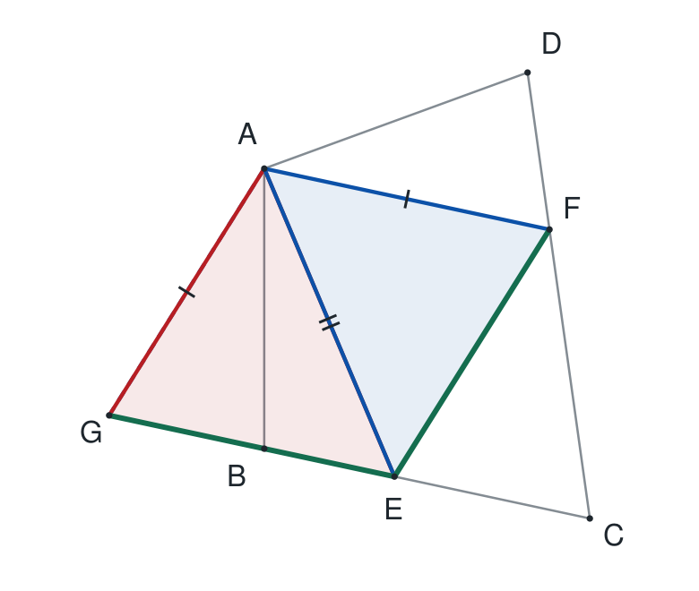

**作图：** 突出第二组全等三角形；半角条件用在A处。

∠GAE=∠BAG+∠BAE

=∠DAF+∠BAE

=∠BAD-∠EAF

=∠EAF（半角条件）。

由AG=AF、AE公共，△GAE≌△FAE（SAS），GE=EF。

依然G、B、E依次共线。

**本步结论：** 结论仍成立：EF=BE+DF。

### （3）第1步：G这次放在B、E之间

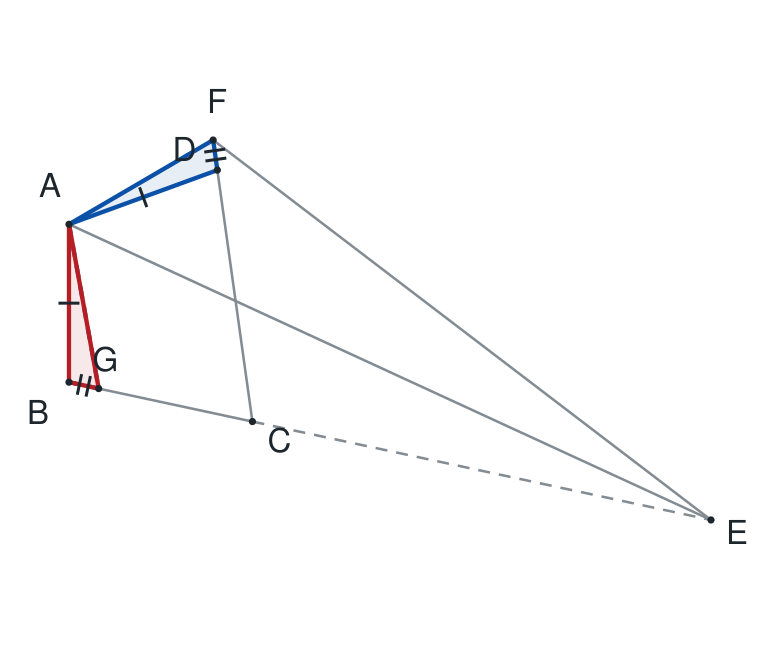

**作图：** 在射线BC上取G，使BG=DF；连AG。不是延长CB。

F在CD越过D的延长线上。

∠ADF=180°-∠ADC=∠ABC=∠ABG。

AB=AD，BG=DF，所以△ABG≌△ADF（SAS）。

得到AG=AF，∠BAG=∠DAF。

**本步结论：** G改放在B朝C的方向；第一组全等仍成立。

### （3）第2步：相等的是GE，最终要做减法

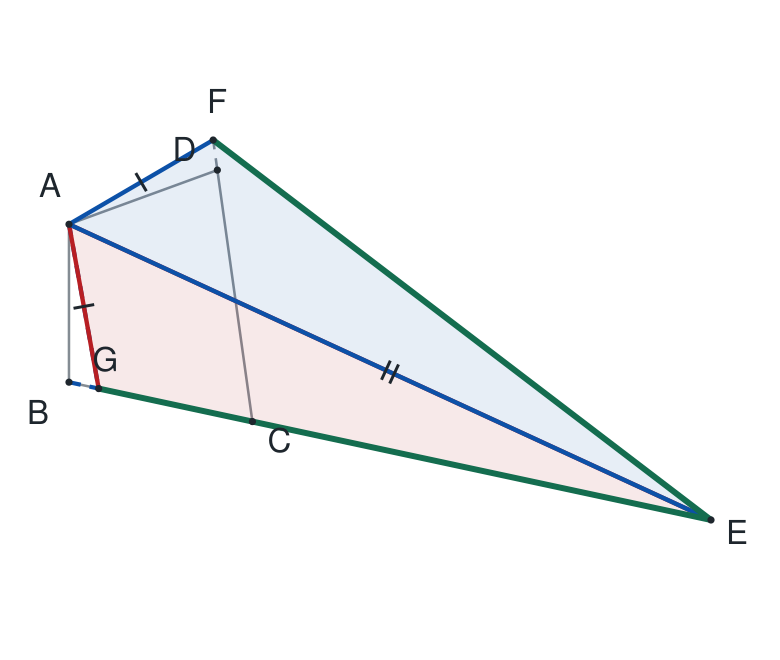

**作图：** 突出△GAE和△FAE，核对B、G、E的顺序。

∠BAE=∠EAF+∠DAF，所以∠GAE=∠BAE-∠BAG=∠EAF。

AG=AF、AE公共，得到△GAE≌△FAE（SAS），GE=EF。

0<∠BAG<∠BAE，所以AG在∠BAE内部，G在BE内部。

GE=BE-BG=BE-DF。

**本步结论：** BE=DF+EF（与前两问的加法关系不同）。

## 第4题：逐步图解

### （1）第1步：PM是哪一个三角形的中点连线？

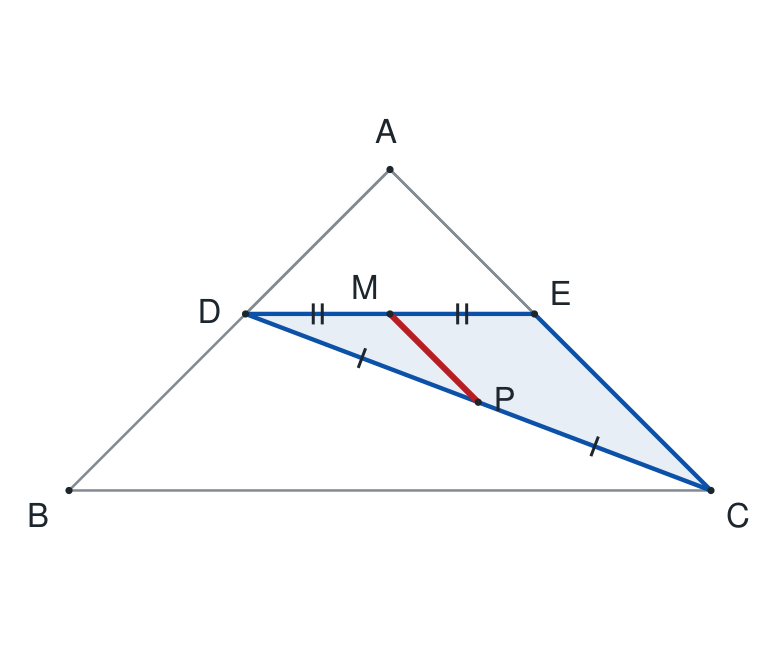

**作图：** 先只突出△DCE，PM用红色画出。

题目说P是DC中点，M是DE中点。

所以DP=PC，DM=ME。

PM连接△DCE的两边中点。

由中点连线性质：

PM∥CE，PM=CE/2。

若学生未学此性质，先讲附录配图证明。

**本步结论：** 第一条关系：PM∥CE，PM=CE/2。

### （1）第2步：PN属于另一个三角形

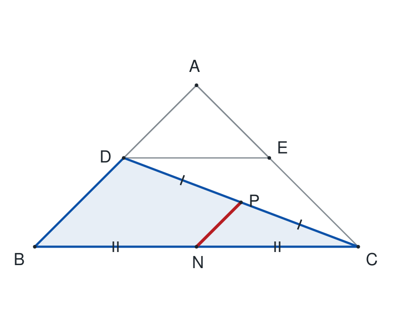

**作图：** 现在改为突出△DCB，PN用红色画出。

P仍是DC中点，但N是BC中点。

所以DP=PC，BN=NC。

PN连接△DCB的两边中点。

因此PN∥DB，PN=DB/2。

注意：PM与PN分别属于两个不同的大三角形。

**本步结论：** 第二条关系：PN∥DB，PN=DB/2。

### （1）第3步：先用初始位置得出答案

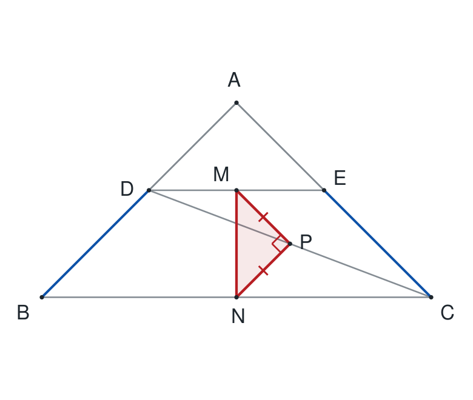

**作图：** 观察未旋转的图：D在AB上，E在AC上。

BD=AB-AD，CE=AC-AE。

AB=AC，AD=AE，所以BD=CE。

AB⊥AC，因此BD⊥CE。

结合前两步，PM=CE/2=BD/2=PN；PM∥CE、PN∥BD，所以PM⊥PN。

**本步结论：** 第（1）问：PM=PN，PM⊥PN。

### （2）第1步：连接BD、CE，证明等长

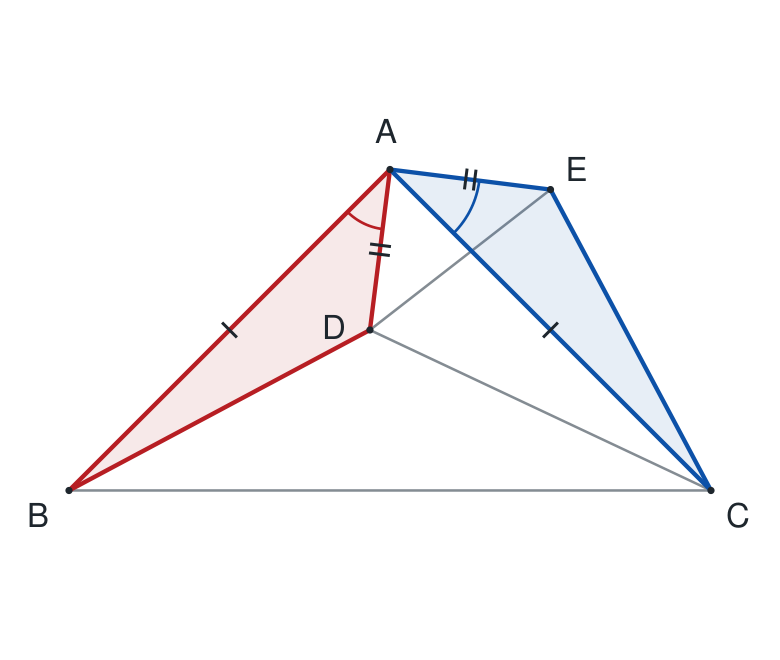

**作图：** 连BD、CE；红色△BAD与蓝色△CAE作对照。

图2中∠BAC=∠DAE=90°，且D在∠BAC内部。

∠BAD=90°-∠DAC。

∠CAE=90°-∠DAC。

所以∠BAD=∠CAE。

AB=AC，AD=AE，故△BAD≌△CAE（SAS）。

**本步结论：** BD=CE；对应顶点是B与C、A与A、D与E。

### （2）第2步：用角度一步步证明垂直

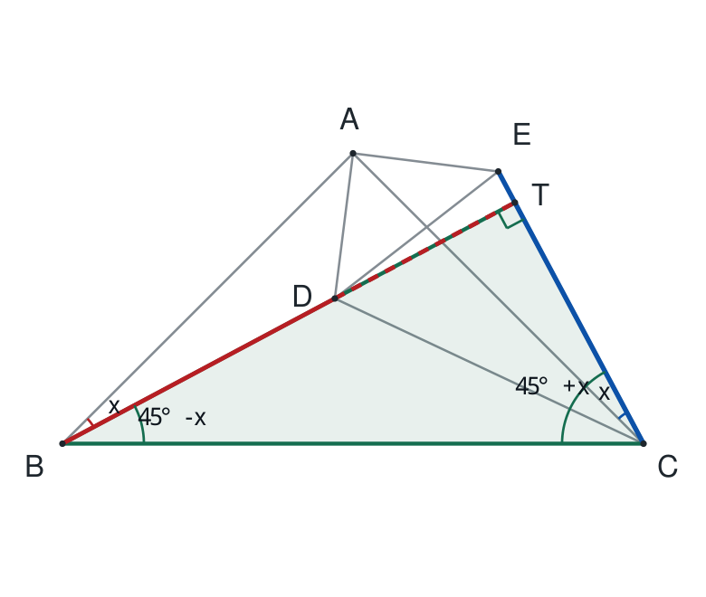

**作图：** 延长BD与CE交于T；突出△BCT，令x=∠ABD。

由刚才全等，∠ACE=∠ABD=x。

等腰直角△ABC中，∠ABC=∠BCA=45°。

∠CBT=45°-x；

∠BCT=45°+x。

所以∠BTC=180°-(45°-x)-(45°+x)=90°。

这里使用图2的点与角位置。

**本步结论：** BD⊥CE。“两边相等”本身不能直接推出垂直。

### （2）第3步：旋转后PM仍是中点连线

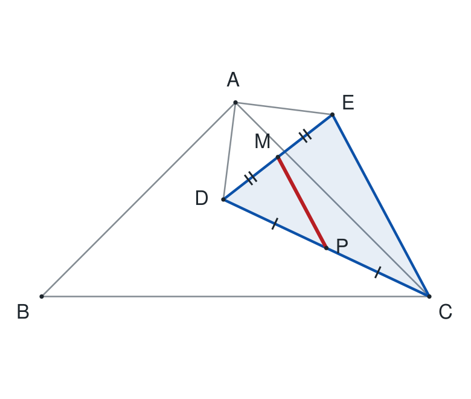

**作图：** 旋转图中单独突出△DCE；突出DP、PC与DM、ME。

D、E的位置改变了，但P始终是DC中点，M始终是DE中点。

因此在新位置的△DCE中，仍然有

PM∥CE，PM=CE/2。

不需要判断PM在图上看起来是水平还是斜着。

**本步结论：** 旋转后依然：PM∥CE，PM=CE/2。

### （2）第4步：旋转后PN仍属于△DCB

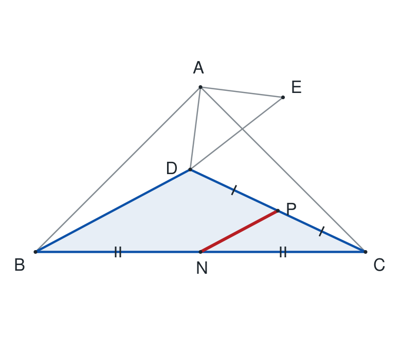

**作图：** 只突出△DCB及红色PN，确认P、N分别在哪两边。

P是DC中点，N是CB中点。

所以在新位置的△DCB中，

PN∥DB，PN=DB/2。

两条小线段的长度与方向，分别由CE和DB决定。

**本步结论：** 旋转后依然：PN∥DB，PN=DB/2。

### （2）第5步：合并等长、垂直两个结论

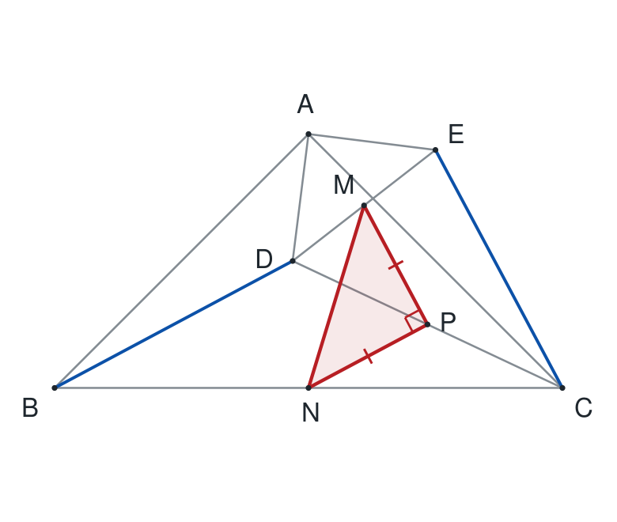

**作图：** 突出小三角形PMN，在P处标直角。

因为BD=CE，

PM=CE/2=BD/2=PN。

因为BD⊥CE，且PN∥BD、PM∥CE，

所以PM⊥PN。

PM与PN相等并互相垂直，故△PMN是等腰直角三角形。

**本步结论：** 第（2）问：△PMN为等腰直角三角形，直角顶点为P。

### （3）第1步：先把面积写成BD的式子

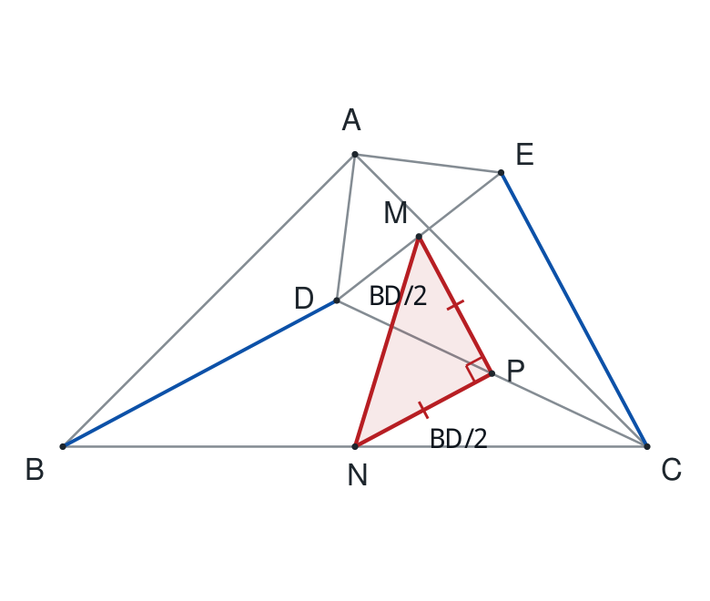

**作图：** 突出两条直角边PM、PN，各标为BD/2。

自由旋转时，绕A逆时针转90°始终把B对应到C、D对应到E，所以BD与CE始终等长且垂直。

于是PM=PN=BD/2。

S△PMN=(1/2)×PM×PN

=(1/2)×(BD/2)×(BD/2)

=BD²/8。

**本步结论：** 面积只随BD的长度改变；BD越长，面积越大。

### （3）第2步：BD最多多长？

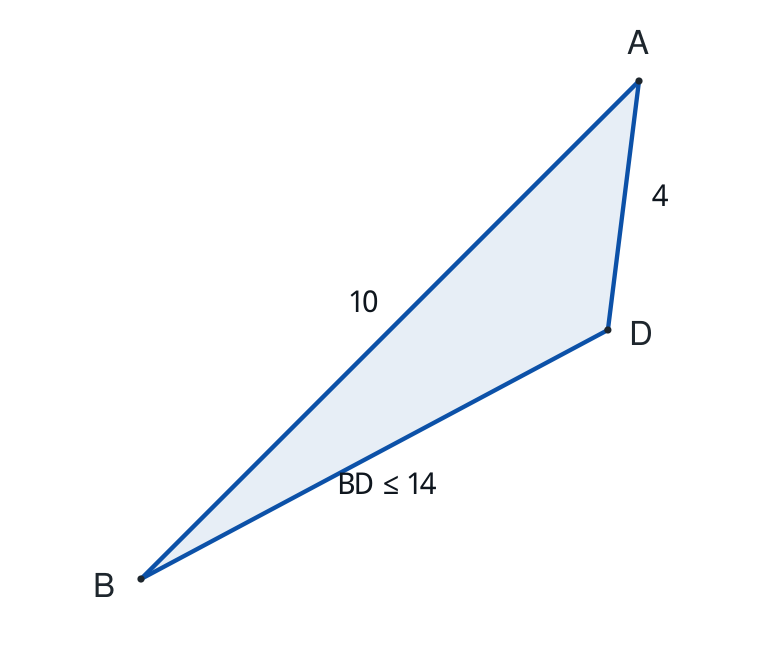

**作图：** 单独画B、A、D及AB=10、AD=4。

从B经过A到D是折线，BD是直接连接B、D的线段。

因此BD≤BA+AD=10+4=14。

一般不共线的位置严格小于14。

要等于14，必须让B、A、D依次共线，也就是A在B与D之间。

**本步结论：** BD的上界为14；必须检查这个位置能否通过旋转得到。

### （3）第3步：画出达到最大值的完整位置

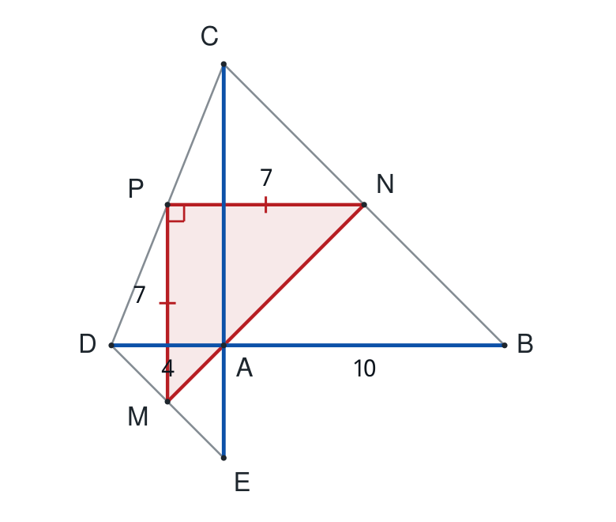

**作图：** 把AD旋转到AB的反向延长线上；重画E、M、P、N。

自由旋转允许D、A、B依次共线。

此时BD=DA+AB=4+10=14。

CE=14，PM=PN=14/2=7。

S△PMN=(1/2)×7×7=49/2。

图中小三角形仍然是等腰直角三角形，没有退化。

**本步结论：** 第（3）问：最大面积49/2；D在AB的反向延长线上时取得。

## 附录：中点连线性质的全等证明

### 引理第1步：延长中点连线，制造第一组全等

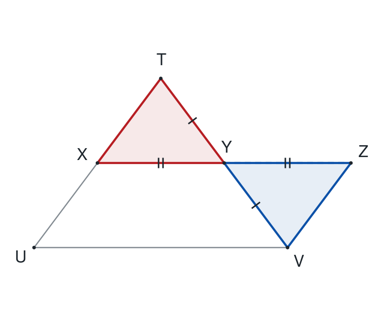

**作图：** △TUV中X、Y为TU、TV中点。延长XY至Z，使YZ=YX。

①TY=YV（Y是中点）。

②YX=YZ（复制长度）。

③∠TYX=∠VYZ（对顶角）。

所以△TYX≌△VYZ（SAS）。

对应边VZ=TX=UX；对应角∠YTX=∠YVZ，故VZ∥UX。

**本步结论：** VZ=UX，VZ∥UX。

### 引理第2步：连UZ，制造第二组全等

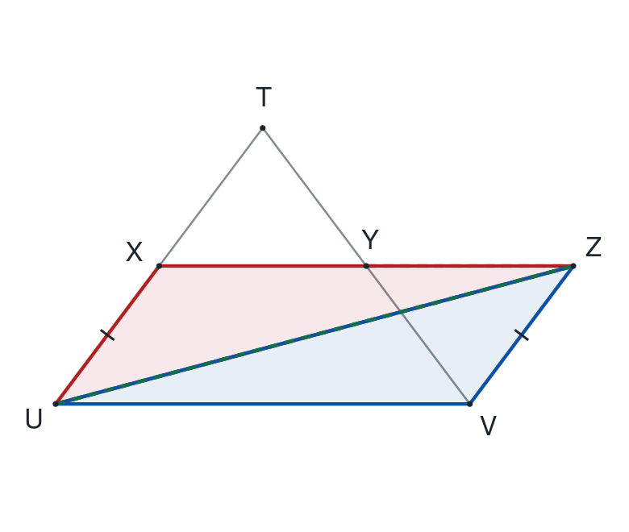

**作图：** 连UZ，突出△XUZ与△VZU。

①UX=VZ（第1步）。

②UZ是公共边。

③∠XUZ=∠VZU（UX∥VZ，内错角相等）。

所以△XUZ≌△VZU（SAS）。

对应边XZ=VU；对应角∠XZU=∠VUZ，故XZ∥VU。

**本步结论：** XZ=UV，XZ∥UV。

### 引理第3步：从整段XZ回到半段XY

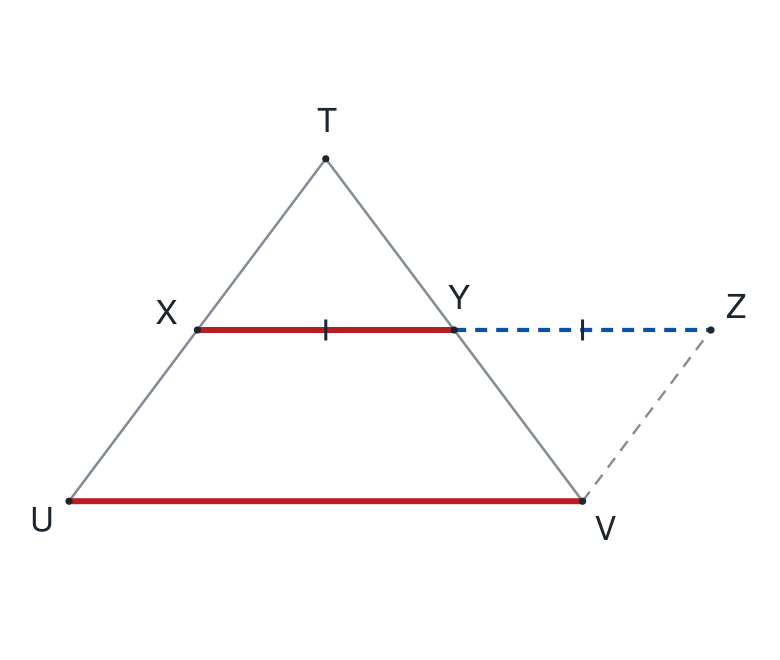

**作图：** 突出原来的XY、底边UV，确认X、Y、Z的顺序。

X、Y、Z依次共线，XY=YZ。

所以XZ=XY+YZ=2XY。

第2步已经证明XZ=UV，因此XY=UV/2。

XY与XZ在同一直线上，故XY∥UV。

**本步结论：** 中点连线性质：XY∥UV，XY=UV/2。两次SAS即可证明。

## 评分与课堂回练

### 第1题：8分评分与提示

AM=EN的全等2分；BM=MN及折线转化2分；固定下界2分；合法取点、顺序及等号2分。提示顺序：①哪条长度能旋转到N附近？②BMN是什么三角形？③折线的端点是否固定？④等号时M落在哪里？记录提示等级。

### 第2题：10分评分与提示

补固定Q并找出EP=FQ、平行关系2分；SAS且说明M为QP中点4分；固定直线、端点和半长关系2分；答案8得2分。提示顺序：①动三角形旁边能否补一个固定三角形？②比较EP和FQ。③已知EF中点，哪两三角形能全等？

### 第3题：20分评分与提示

（1）正确关系4分。（2）判断2分，复制长度与第一次全等3分，第二次全等及结论3分。（3）关系2分，复制长度及第一次全等2分，第二次全等2分，点的顺序与减法2分。提示先问“需要搬哪一段”，再问“复制长度放在B的哪边”，最后才给G。

### 第4题：22分评分与提示

（1）两关系各2分。（2）BD=CE的全等或明确旋转理由4分；BD⊥CE的方向理由2分；两条中点连线4分；等腰直角结论2分。（3）面积化为BD²/8得2分；上界及49/2得2分；合法取等位置2分。

### 12分钟回练：不再另编新题

遮住答案，按讲解内容选两项：A．第1题只给“AM=EN”，重新写出剩下的下界、取等顺序及M的位置；B．第2题只给固定Q，重新证明M是QP中点并求轨迹长；C．第3题只看图3，独立决定G放在哪一侧并写出两次SAS；D．第4题只看第（3）问，独立写出面积式、上界和等号位置。约8分钟重做、4分钟核对。这里是原题关键步骤的回练，不能将短时间重做成功视为陌生题迁移已完全掌握。

### 课后再测

下一次应选一份未见过的同型现成题再测，以确认迁移。本包不把改数字的自编题冒充公开题，也不将同题即时重做当作第二套独立测试。

### 出处与核对程度

第1—3题来自Onion12138/math的《初中数学总复习讲义》1.5.1，有原图和可定位的例题、习题号；第4题来自higyg/middleschoolmath-ebook的T22-A01-10，原题库明确标注2017年河南中考，原解给出了PM=PN、PM⊥PN及49/2。本包独立补全证明，但未取得官方试卷对照，不宣称学校来源或官方授权。README提供固定版本原链接、题目摘录和许可文件。

### 记录表

独立摸底____/60；自想到的辅助线：________。
卡点：□夹角 □复制长度 □旋转对应 □中点引理 □线段顺序 □等号位置。
提示等级：□独立 □口头方向 □给出辅助线 □完整示范。
回练完成：________；下一课要用陌生题再测：________。
